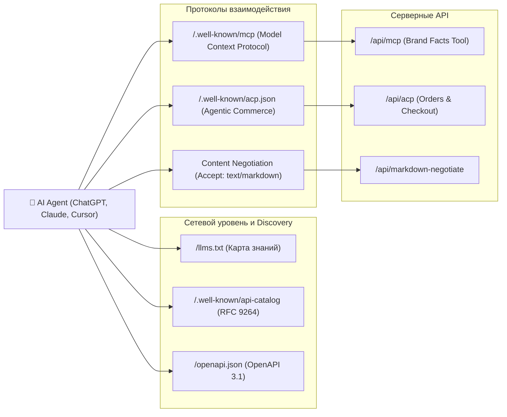

# 🤖 Архитектура AI-агентов и Протоколов (AI Agent Architecture)

#architecture #ai-agents #mcp #acp #llms-txt #markdown-negotiation #rag

> **Назначение:** Архитектурный стандарт подготовки веб-ресурсов к взаимодействию с автономными AI-агентами (LLM Crawlers, Shopping Agents, Coding Assistants, Context Servers).

---

## 1. Стек протоколов агентской экосистемы



---

## 2. Model Context Protocol (MCP / SEP-1960)

### 2.1. Discovery Manifest (`/.well-known/mcp`)
Позволяет AI-агентам обнаружить доступные инструменты без парсинга HTML.

```json
{
  "protocol": "mcp",
  "version": "2024-11-05",
  "server": {
    "name": "erythro-ai-brand-mcp",
    "version": "1.0.0",
    "description": "Official Erythro.ai MCP server for brand facts and agency capabilities"
  },
  "endpoints": {
    "facts": "https://erythro.ai/api/mcp",
    "tools": "https://erythro.ai/api/mcp",
    "resources": "https://erythro.ai/api/mcp"
  },
  "documentation_url": "https://erythro.ai/llms.txt"
}
```

### 2.2. Tool Execution (`/api/mcp`)
Возвращает канонические факты о бренде, локациях, услугах и юридических лицах для исключения галлюцинаций в ответах ассистентов.

---

## 3. Agentic Commerce Protocol (ACP)

Стандарт агентской коммерции ([agenticcommerce.dev](https://agenticcommerce.dev)), поддерживаемый OpenAI и Stripe.

### 3.1. Discovery Document (`/.well-known/acp.json`)
```json
{
  "protocol": {
    "name": "acp",
    "version": "2025-01",
    "supported_versions": ["2025-01", "1.0.0", "0.1"]
  },
  "api_base_url": "https://erythro.ai/api/acp",
  "transports": ["http", "rest", "mcp"],
  "capabilities": {
    "services": [
      "catalog",
      "checkout",
      "orders",
      "delegate_payment"
    ],
    "extensions": [
      "currency_conversion",
      "localized_content"
    ]
  },
  "merchant": {
    "name": "Erythro.ai",
    "url": "https://erythro.ai",
    "contact": {
      "email": "order@erythro.ai",
      "phone": "+972 50 530 83 05"
    }
  },
  "endpoints": {
    "catalog": "https://erythro.ai/order",
    "contact": "https://erythro.ai/contacts",
    "mcp": "https://erythro.ai/api/mcp"
  },
  "documentation_url": "https://erythro.ai/llms.txt"
}
```

---

## 4. Markdown Content Negotiation

Когда агент отправляет заголовок `Accept: text/markdown`, сервер отдает чистый структурированный текст вместо тяжелого HTML-кода.

### 4.1. Обязательные заголовки ответа:
- `Content-Type: text/markdown; charset=utf-8`
- `x-markdown-tokens: <token_count>` (оценка токенов: `Math.ceil(length / 4)`)
- `Vary: Accept, Accept-Language, Cookie` (предотвращает загрязнение кэша браузера)
- `content-signal: ai-train=yes, search=yes`

### 4.2. Механизм в Next.js Middleware:
```typescript
// src/middleware.ts
const wantsMarkdown =
  !pathname.startsWith('/api') &&
  !pathname.startsWith('/admin') &&
  shouldServeMarkdown(request.headers.get('accept'))

if (wantsMarkdown) {
  const url = request.nextUrl.clone()
  url.pathname = '/api/markdown-negotiate'
  url.searchParams.set('path', pathname)
  return NextResponse.rewrite(url)
}
```

---

## 5. `llms.txt` и Schema.org (JSON-LD)

1. **`llms.txt` в корне (`/llms.txt`):** Содержит краткое резюме компании, ссылки на канонические страницы (`/about`, `/contacts`, `/services`), информацию о протоколах.
2. **Schema.org JSON-LD:**
   - `Organization`: Название, адрес, контакты, соцсети (`sameAs`).
   - `WebSite`: Название, описание, поиск.
   - `FAQPage`: Структурированные вопросы и ответы.
   - `Service` / `Product`: Структурированные карточки услуг с ценами и валютой.
3. **Robots.txt:** Явное разрешение доступа для поисковых и агентских ботов (`GPTBot`, `ClaudeBot`, `PerplexityBot`, `Google-Extended`).

---

## 6. Оценка качества и оптимизация RAG (RAG Evaluation)

Комплексный регламент тестирования точности поиска (Precision@k, MRR, NDCG), устранения галлюцинаций и метрик генерации (Faithfulness, Groundedness, Context Precision) описан в отдельном архитектурном стандарте:
👉 **[[rag-evaluation-guide|Руководство по оценке и оптимизации RAG-систем]]**.
