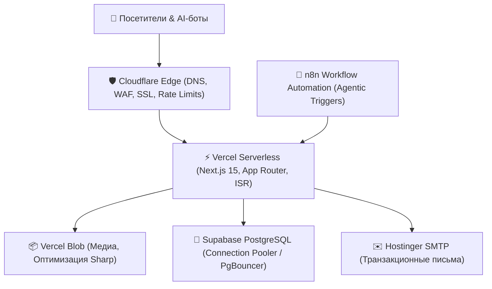

# 🌐 Инфраструктура, DevOps и Безопасность (DevOps & Infra)

#architecture #devops #infra #vercel #cloudflare #supabase #docker #security #ci-cd

> **Назначение:** Архитектурный регламент развертывания, сетевой безопасности, защиты от атак, мониторинга и автоматизации CI/CD в продакшене.

---

## 1. Топология продакшен-инфраструктуры



---

## 2. Безопасность и Security Headers

Каждый ответ веб-сервера обязан содержать базовый набор заголовков безопасности (A+ по SecurityHeaders.com):

```typescript
// next.config.ts
const securityHeaders = [
  { key: 'X-DNS-Prefetch-Control', value: 'on' },
  { key: 'Strict-Transport-Security', value: 'max-age=63072000; includeSubDomains; preload' },
  { key: 'X-Frame-Options', value: 'SAMEORIGIN' },
  { key: 'X-Content-Type-Options', value: 'nosniff' },
  { key: 'Referrer-Policy', value: 'origin-when-cross-origin' },
  { key: 'Permissions-Policy', value: 'camera=(), microphone=(), geolocation=()' },
]
```

---

## 3. Настройка Cloudflare WAF и Rate Limiting

### 3.1. Contact Form & Lead Rate Limiting
Для защиты от спам-атак и DDoS на формы заявок (`/api/contact`, `/api/audit`):
- **Cloudflare Rate Limit:** Не более 5 POST-запросов в минуту с одного IP.
- **In-App Rate Limit:** In-memory LRU / KV store ограничитель на уровне Route Handler (возврат 429 Too Many Requests).
- **Honeypot:** Скрытое поле `website_hp`, невидимое для людей, заполнение которого ботом блокирует отправку со статусом 200 (silent reject).

---

## 4. База данных Supabase & PgBouncer

1. **Session Pooler (Port 5432):** Используется для миграций и инициализации Payload CMS.
2. **Transaction Pooler (Port 6543):** Используется для Serverless Edge функций с высокой параллельностью.
3. **Бекапы и шифрование:**
   - Регулярный дамп через скрипт `scripts/backup-db.mjs`.
   - Симметричное шифрование AES-256-GCM через ключ `BACKUP_ENCRYPTION_KEY`.
   - Полное соответствие закону о защите персональных данных (Израиль, Поправка №13).

---

## 5. Пайплайн CI/CD (GitHub Actions)

Файл `.github/workflows/test.yml`:
- Прогон линтера: `pnpm lint`
- Проверка типов: `pnpm tsc --noEmit`
- Интеграционные тесты: `pnpm test:int` (Vitest)
- E2E тесты: `pnpm test:e2e` (Playwright)
- Автоматический деплой на Vercel при успешном прохождении тестов в ветке `main`.
