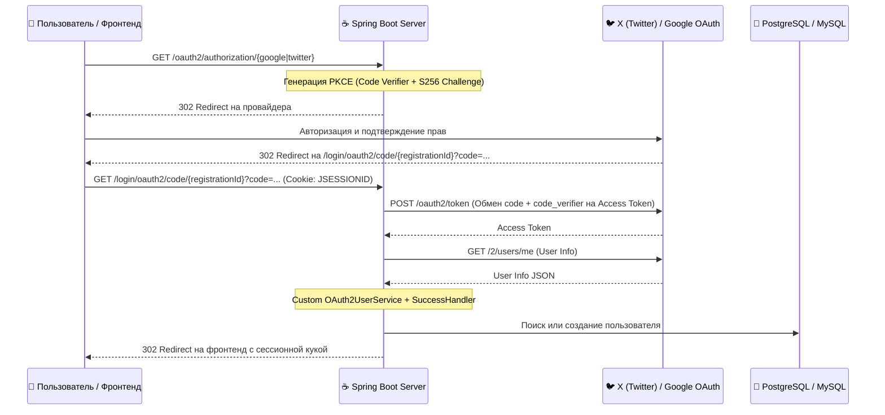

# ☕ Архитектура Spring Boot, OAuth 2.0 и Java-сервисов

#architecture #backend #spring-boot #java #oauth2 #google #twitter-x #security #pkce #email-service

> **Назначение:** Полный технический регламент для интеграции Spring Security 6, авторизации через Google и X (Twitter) OAuth 2.0 с PKCE, настройки сессионных cookie за Nginx/Cloudflare и формирования транзакционных HTML-писем с inline-вложениями (CID). Основано на боевом опыте проекта Montblanc.

---

## 1. Архитектура аутентификации OAuth 2.0



---

## 2. Специфика и различия провайдеров (Google vs X/Twitter)

| Параметр | Google OAuth 2.0 | X (Twitter) OAuth 2.0 |
|---|---|---|
| **Стандарт** | OpenID Connect (OIDC) | Чистый OAuth 2.0 (RFC 6749) |
| **PKCE (RFC 7636)** | Опционально | **СТРОГО ОБЯЗАТЕЛЕН** (Code Challenge S256) |
| **Client Auth Method** | `client_secret_post` | `client_secret_basic` (Basic Auth в заголовке) |
| **User Info Endpoint** | `https://openidconnect.googleapis.com/v1/userinfo` | `https://api.twitter.com/2/users/me` |
| **Формат User Info** | Плоский JSON (`sub`, `email`, `name`, `picture`) | Вложенный объект: `{ "data": { "id", "name", "username", "profile_image_url" } }` |
| **Наличие Email** | Да (поле `email`) | **Нет** — необходимо генерировать `username@x.local` |
| **Scopes** | `openid,profile,email` | `users.read,tweet.read,offline.access` |

---

## 3. Конфигурация Spring Boot (`application.properties`)

```properties
# 1. Корректная обработка заголовков X-Forwarded-* за Nginx / Cloudflare
server.forward-headers-strategy=framework

# 2. Сессионные Cookie для кросс-доменных редиректов (SameSite=None + Secure)
server.servlet.session.cookie.same-site=none
server.servlet.session.cookie.secure=true
server.servlet.session.cookie.http-only=true

# 3. Google OAuth2 (стандартный OIDC провайдер)
spring.security.oauth2.client.registration.google.client-id=${GOOGLE_CLIENT_ID}
spring.security.oauth2.client.registration.google.client-secret=${GOOGLE_CLIENT_SECRET}
spring.security.oauth2.client.registration.google.scope=openid,profile,email
spring.security.oauth2.client.registration.google.redirect-uri={baseUrl}/login/oauth2/code/{registrationId}

# 4. X (Twitter) OAuth2 (кастомный OAuth 2.0 провайдер)
spring.security.oauth2.client.registration.twitter.client-id=${TWITTER_CLIENT_ID}
spring.security.oauth2.client.registration.twitter.client-secret=${TWITTER_CLIENT_SECRET}
spring.security.oauth2.client.registration.twitter.client-authentication-method=client_secret_basic
spring.security.oauth2.client.registration.twitter.authorization-grant-type=authorization_code
spring.security.oauth2.client.registration.twitter.scope=users.read,tweet.read,offline.access
spring.security.oauth2.client.registration.twitter.redirect-uri={baseUrl}/login/oauth2/code/{registrationId}

# Эндпоинты X API v2
spring.security.oauth2.client.provider.twitter.authorization-uri=https://twitter.com/i/oauth2/authorize
spring.security.oauth2.client.provider.twitter.token-uri=https://api.twitter.com/2/oauth2/token
spring.security.oauth2.client.provider.twitter.user-info-uri=https://api.twitter.com/2/users/me
spring.security.oauth2.client.provider.twitter.user-name-attribute=id
```

---

## 4. Реализация PKCE в `SecurityConfig.java`

По умолчанию Spring Security не включает PKCE для нестандартных OIDC-клиентов. Необходима кастомизация `AuthorizationRequestResolver`:

```java
package com.montblanc.montblanc.Config;

import org.springframework.context.annotation.Bean;
import org.springframework.context.annotation.Configuration;
import org.springframework.security.config.annotation.web.builders.HttpSecurity;
import org.springframework.security.oauth2.client.registration.ClientRegistrationRepository;
import org.springframework.security.oauth2.client.web.DefaultOAuth2AuthorizationRequestResolver;
import org.springframework.security.oauth2.client.web.OAuth2AuthorizationRequestRedirectFilter;
import org.springframework.security.oauth2.core.endpoint.OAuth2AuthorizationRequest;
import org.springframework.security.oauth2.core.endpoint.PkceParameterNames;
import org.springframework.security.web.SecurityFilterChain;

import java.nio.charset.StandardCharsets;
import java.security.MessageDigest;
import java.security.NoSuchAlgorithmException;
import java.security.SecureRandom;
import java.util.Base64;

@Configuration
public class SecurityConfig {

    @Bean
    public SecurityFilterChain filterChain(HttpSecurity http, 
                                           ClientRegistrationRepository clientRegistrationRepository,
                                           CustomAuthenticationSuccessHandler successHandler,
                                           TwitterOAuth2UserService twitterOAuth2UserService) throws Exception {
        
        DefaultOAuth2AuthorizationRequestResolver resolver = new DefaultOAuth2AuthorizationRequestResolver(
                clientRegistrationRepository,
                OAuth2AuthorizationRequestRedirectFilter.DEFAULT_AUTHORIZATION_REQUEST_BASE_URI
        );
        resolver.setAuthorizationRequestCustomizer(this::addPkceParameters);

        http
            .csrf(csrf -> csrf.disable())
            .authorizeHttpRequests(auth -> auth
                .requestMatchers("/", "/login/**", "/oauth2/**", "/static/**", "/api/public/**").permitAll()
                .anyRequest().authenticated()
            )
            .oauth2Login(oauth2 -> oauth2
                .authorizationEndpoint(auth -> auth.authorizationRequestResolver(resolver))
                .userInfoEndpoint(userInfo -> userInfo.userService(twitterOAuth2UserService))
                .successHandler(successHandler)
            );

        return http.build();
    }

    private void addPkceParameters(OAuth2AuthorizationRequest.Builder builder) {
        try {
            String codeVerifier = generateCodeVerifier();
            String codeChallenge = createS256CodeChallenge(codeVerifier);

            builder.attributes(attrs -> attrs.put(PkceParameterNames.CODE_VERIFIER, codeVerifier));
            builder.additionalParameters(params -> {
                params.put(PkceParameterNames.CODE_CHALLENGE, codeChallenge);
                params.put(PkceParameterNames.CODE_CHALLENGE_METHOD, "S256");
            });
        } catch (Exception e) {
            throw new RuntimeException("Failed to generate PKCE challenge", e);
        }
    }

    private static String generateCodeVerifier() {
        SecureRandom secureRandom = new SecureRandom();
        byte[] bytes = new byte[96];
        secureRandom.nextBytes(bytes);
        return Base64.getUrlEncoder().withoutPadding().encodeToString(bytes);
    }

    private static String createS256CodeChallenge(String codeVerifier) throws NoSuchAlgorithmException {
        byte[] digest = MessageDigest.getInstance("SHA-256")
                .digest(codeVerifier.getBytes(StandardCharsets.US_ASCII));
        return Base64.getUrlEncoder().withoutPadding().encodeToString(digest);
    }
}
```

---

## 5. Парсинг вложенного ответа X UserInfo (`TwitterOAuth2UserService.java`)

```java
package com.montblanc.montblanc.Config;

import org.springframework.core.ParameterizedTypeReference;
import org.springframework.http.*;
import org.springframework.security.core.authority.SimpleGrantedAuthority;
import org.springframework.security.oauth2.client.userinfo.DefaultOAuth2UserService;
import org.springframework.security.oauth2.client.userinfo.OAuth2UserRequest;
import org.springframework.security.oauth2.client.userinfo.OAuth2UserService;
import org.springframework.security.oauth2.core.OAuth2AuthenticationException;
import org.springframework.security.oauth2.core.user.DefaultOAuth2User;
import org.springframework.security.oauth2.core.user.OAuth2User;
import org.springframework.stereotype.Service;
import org.springframework.web.client.RestTemplate;

import java.util.*;

@Service
public class TwitterOAuth2UserService implements OAuth2UserService<OAuth2UserRequest, OAuth2User> {

    private final DefaultOAuth2UserService delegate = new DefaultOAuth2UserService();
    private final RestTemplate restTemplate = new RestTemplate();

    @Override
    public OAuth2User loadUser(OAuth2UserRequest userRequest) throws OAuth2AuthenticationException {
        String clientRegId = userRequest.getClientRegistration().getRegistrationId();

        // Для Google и остальных используем стандартный делегат
        if (!"twitter".equals(clientRegId)) {
            return delegate.loadUser(userRequest);
        }

        // Кастомная обработка X (Twitter) API v2
        String userInfoUri = userRequest.getClientRegistration().getProviderDetails().getUserInfoEndpoint().getUri();
        String url = userInfoUri + "?user.fields=id,name,username,profile_image_url";

        HttpHeaders headers = new HttpHeaders();
        headers.setBearerAuth(userRequest.getAccessToken().getTokenValue());
        HttpEntity<?> entity = new HttpEntity<>(headers);

        ResponseEntity<Map<String, Object>> response = restTemplate.exchange(
                url,
                HttpMethod.GET,
                entity,
                new ParameterizedTypeReference<Map<String, Object>>() {}
        );

        Map<String, Object> body = response.getBody();
        if (body == null || !body.containsKey("data")) {
            throw new OAuth2AuthenticationException("invalid_user_info_response");
        }

        @SuppressWarnings("unchecked")
        Map<String, Object> data = (Map<String, Object>) body.get("data");

        return new DefaultOAuth2User(
                Collections.singleton(new SimpleGrantedAuthority("ROLE_USER")),
                data,
                "username"
        );
    }
}
```

---

## 6. Транзакционный Email-сервис с Inline-вложениями (CID)

**Проблема:** Почтовые клиенты (Gmail, Mail.ru, Outlook) блокируют `data:image/...` (base64) и внешние URL картинок в письмах.  
**Решение:** Внедрение изображений через `MimeMessageHelper.addInline(cid, resource, mime)` со ссылкой ``.

```java
package com.montblanc.montblanc;

import jakarta.mail.MessagingException;
import jakarta.mail.internet.MimeMessage;
import org.springframework.core.io.ByteArrayResource;
import org.springframework.mail.javamail.JavaMailSender;
import org.springframework.mail.javamail.MimeMessageHelper;
import org.springframework.stereotype.Service;

import java.util.Map;

@Service
public class EmailService {

    private final JavaMailSender javaMailSender;

    public EmailService(JavaMailSender javaMailSender) {
        this.javaMailSender = javaMailSender;
    }

    public void sendWithInlineImages(String to, String subject, String htmlBody, Map<String, byte[]> inlineImages) throws MessagingException {
        MimeMessage message = javaMailSender.createMimeMessage();
        MimeMessageHelper helper = new MimeMessageHelper(message, true, "UTF-8");

        helper.setFrom("order@montblanc.local");
        helper.setTo(to);
        helper.setSubject(subject);
        helper.setText(htmlBody, true); // true = HTML

        if (inlineImages != null) {
            for (Map.Entry<String, byte[]> entry : inlineImages.entrySet()) {
                String cid = entry.getKey();
                byte[] bytes = entry.getValue();
                String contentType = detectContentType(bytes);
                helper.addInline(cid, new ByteArrayResource(bytes), contentType);
            }
        }

        javaMailSender.send(message);
    }

    private String detectContentType(byte[] bytes) {
        if (bytes != null && bytes.length >= 4) {
            // PNG signature: 89 50 4E 47
            if ((bytes[0] & 0xFF) == 0x89 && bytes[1] == 0x50 && bytes[2] == 0x4E && bytes[3] == 0x47) {
                return "image/png";
            }
        }
        return "image/jpeg";
    }
}
```

---

## 7. Чеклист траблшутинга Spring Security OAuth2

| Ошибка | Первопричина | Проверенное решение |
|---|---|---|
| **400 "Something went wrong"** | Отсутствует PKCE при авторизации в Twitter | Добавить `addPkceParameters` в `DefaultOAuth2AuthorizationRequestResolver` |
| **authorization_request_not_found** | Сессионная кука теряется при межсайтовом редиректе с twitter.com | Выставить `same-site=none` и `secure=true` |
| **401 при обмене `code` на `token`** | Использован `client_secret_post` вместо `client_secret_basic` | Указать `client-authentication-method=client_secret_basic` |
| **403 на `/2/users/me`** | Отсутствует scope `users.read` | Проверить параметр `scope` в `application.properties` |
| **`invalid_user_info_response`** | `DefaultOAuth2UserService` пытается прочесть корень JSON вместо `data` | Использовать кастомный `TwitterOAuth2UserService` |
| **Неверный `redirect_uri` за Nginx** | Схема протокола подменяется на `http://` | Включить `server.forward-headers-strategy=framework` и прокси-заголовки `X-Forwarded-Proto: https` |

---

## 8. Ролевая модель панели управления (RBAC: Super Admin vs Customer)

Для разделения доступа к данным заказов используется поле `category` сущности `User`:
- **`category = 'admin'` (Super Admin):** полный доступ ко всем заказам магазина (`ordersRepository.findAll()`), глобальной статистике продаж, управлению товарами (`/admin/products`), категориями (`/admin/categories`) и удалению заказов.
- **`category = 'user'` (Customer / Личный кабинет):** разрешён вход в кабинет `/admin` («Мои заказы»), где отображаются **только собственные заказы** пользователя по `userId` и `email` (`ordersRepository.findByUserIdOrEmailOrderByIdDesc()`). Управление товарами, категориями и удаление заказов надёжно закрыты на уровне бэкенда проверкой `checkAdmin(session)` (HTTP 403) и скрыты в интерфейсе.

### 8.1 Регистрация покупателей и Cart Auth Guard
- Эндпоинт `POST /api/register` регистрирует нового покупателя с `category = 'user'`.
- Если неавторизованный пользователь открывает модалку корзины, кнопка действия отображает «АВТОРИЗАЦИЯ» (`sign_in`) вместо «ЗАКАЗАТЬ» (`order`) и ведёт на `/sign-in?redirect=/order`.
- Страницы входа (`/sign-in`) и регистрации (`/sign-up`) поддерживают параметр `?redirect=...`, автоматически направляя пользователя сразу на оформление заказа (`/order`) после успешной аутентификации.
