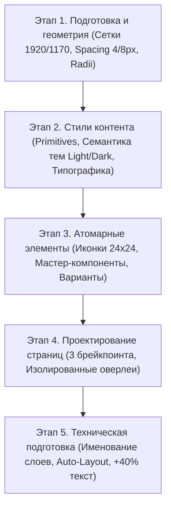

# 🎨 Пайплайн работы в Figma и трансляция в код (Figma Design Pipeline)

#design-tokens #figma #pipeline #workflow #components #ui-kit #auto-layout

> **Назначение:** Полный 5-этапный инженерный регламент проектирования дизайн-систем в Figma и их безупречной трансляции в кодовую базу Tailwind CSS / React без потерь и визуальных расхождений.

---

## 🗺️ 5-этапный процесс проектирования

---

## Этап 1. Подготовка и геометрия (Foundations — Начало)

1. **Создание сетки (Grid Scale):**
   - **Десктоп (Desktop):** 1920px (ограничитель контента `1170px`, 12 колонок по 70px, гаттер 30px, поля 30px).
   - **Планшет (Tablet):** 768px / 1024px (6 колонок, гаттер 20px, поля 24px).
   - **Мобильная версия (Mobile):** 360px / 390px (4 колонки, гаттер 16px, поля 16px).

2. **Определение шага отступов (Spacing Scale):**
   - Жесткая привязка к сетке, кратной **4px** или **8px**: `4px`, `8px`, `12px`, `16px`, `24px`, `32px`, `48px`, `64px`, `96px`.
   - Полный запрет случайных «мусорных» значений (`margin: 13px`).

3. **Настройка скруглений (Radii):**
   - `Radius-S` (4px / 8px) — бейджи, инпуты.
   - `Radius-M` (12px / 16px) — карточки услуг, модалки.
   - `Radius-Max` (9999px) — круглые кнопки, пилюли статусов.

---

## Этап 2. Стили контента (Foundations — Наполнение)

4. **Цветовая палитра: Примитивы (Primitives):**
   - Шкалы чистых цветов: `Coal/900` (#0D0D0D), `Coal/800` (#1A1A1A), `Erythro` (#E50000), `Gold` (#D4AF37).

5. **Семантические токены и Темы (Themes):**
   - Привязка примитивов к смысловым именам в Figma Variables:
     - `bg-primary`: Светлая — `#FFFFFF`, Темная — `Coal/900`.
     - `bg-surface`: Светлая — `#FDFBF7`, Темная — `Coal/800`.
     - `text-main`: Светлая — `#0D0D0D`, Темная — `#F5F5F5`.

6. **Типографика (Typography):**
   - Иерархия стилей: Hero Display H1, H2, H3, H4, Body Large, Body, Caption, Mono Badge.
   - Для каждого стиля строго фиксируются `font-family`, `font-size`, `font-weight`, `line-height`.

---

## Этап 3. Атомарные элементы (Components)

7. **Иконографика (Icons):**
   - Все пиктограммы упаковываются в **строго квадратный фрейм одинакового размера** (`24x24 px`). Это предотвращает «прыжки» иконок в коде при их динамической замене.

8. **Мастер-компоненты и варианты (Variants):**
   - Объединение элементов в `Component Sets` со всеми состояниями:
     - `State=Default` (по умолчанию)
     - `State=Hover` (наведение)
     - `State=Active` / `Focus` (нажатие / клавиатурный фокус)
     - `State=Disabled` (заблокировано)

---

## Этап 4. Проектирование страниц (UX/UI)

9. **Отрисовка страниц во всех темах и адаптивах:**
   - Запрещено использовать «сырые» HEX-коды; все элементы привязаны к токенам.

10. **Изолированные оверлеи (Overlays):**
    - Для мобильных бургер-меню и модальных окон создается отдельный изолированный фрейм размером *только* с само всплывающее окно (не дублируя весь экран телефона).

---

## Этап 5. Техническая подготовка (Для AI и разработчиков)

11. **Именование слоев («Говорящие имена»):**
    - Избавление от названий `Frame 1024` или `Group 5`.
    - Именование слоев в техническом стиле: `button-primary`, `input-search`, `card-service`, `theme-switcher`, `mobile-overlay`.

12. **Стресс-тест на мультиязычность (+40% текста):**
    - Проверка текстовых контейнеров на самом длинном языке (русский).
    - Настройка блоков через **Auto Layout**, чтобы при росте длины строки верстка автоматически раздвигалась.

---

## ✅ Чек-лист «Definition of Done» (Макет готов к верстке)

- [ ] Цвета, шрифты, отступы привязаны к Figma Variables / Styles.
- [ ] Все отступы кратны шагу сетки (4px / 8px).
- [ ] Слои переименованы на английском техническом языке.
- [ ] Переключение темы с Light на Dark не ломает цвета и контрастность.
- [ ] Компоненты проверены на переполнение текстом (+40% Auto Layout).
- [ ] Все иконки упакованы во фреймы 24×24px.
