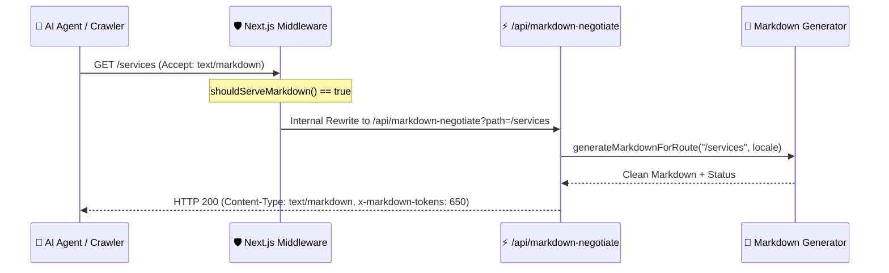

# 📄 Скилл: Markdown Content Negotiation

#agent-skills #markdown-negotiation #content-negotiation #llms #tokens #middleware

> **Назначение:** Доставка чистого структурированного Markdown для AI-краулеров и LLM-агентов вместо перегруженного HTML при запросе с заголовком `Accept: text/markdown`.

---

## 1. Архитектура Content Negotiation



---

## 2. Алгоритм парсинга качества `Accept` заголовка

Функция `shouldServeMarkdown` вычисляет относительный вес (`q-value`) между `text/markdown`, `text/x-markdown`, `text/vnd.markdown` и `text/html`.

```typescript
// src/lib/markdownNegotiation.ts
export function shouldServeMarkdown(acceptHeader: string | null): boolean {
  if (!acceptHeader || acceptHeader.trim() === '') return false

  const mediaRanges = parseAcceptHeader(acceptHeader)
  let markdownQ = 0
  let htmlQ = 0

  for (const item of mediaRanges) {
    if (
      item.mime === 'text/markdown' ||
      item.mime === 'text/x-markdown' ||
      item.mime === 'text/vnd.markdown'
    ) {
      if (item.q > markdownQ) markdownQ = item.q
    } else if (item.mime === 'text/html') {
      if (item.q > htmlQ) htmlQ = item.q
    }
  }

  // Если markdown явно запрошен и его приоритет не ниже HTML
  return markdownQ > 0 && markdownQ >= htmlQ
}
```

---

## 3. Обязательные заголовки ответа

- `Content-Type: text/markdown; charset=utf-8`
- `x-markdown-tokens: <token_count>` (оценка: `Math.ceil(text.length / 4)`)
- `Vary: Accept, Accept-Language, Cookie`
- `Cache-Control: public, max-age=3600, s-maxage=86400, stale-while-revalidate=86400`
- `content-signal: ai-train=yes, search=yes`

---

## 4. Обнаружение через HTML `<head>`

Для подсказки роботам в `layout.tsx` внедряется тег:
```html
<link rel="alternate" type="text/markdown" href="/" />
```
