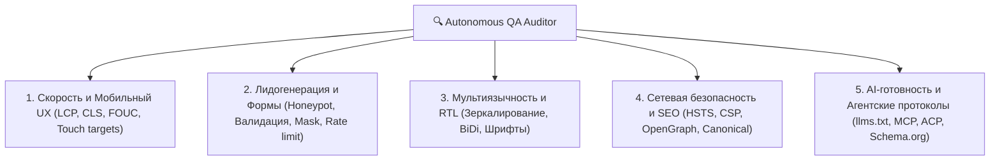

# 🔍 Скилл: Автономный QA Website Auditor

#agent-skills #qa-auditor #playwright #python #java #reports #audit #wcag

> **Назначение:** Архитектура и регламент автономного QA-агента для коммерческого аудита сайтов по 60+ чекпоинтам (UX, RTL, формы, скорость, безопасность, AI-готовность).

---

## 1. 5 Столпов коммерческого аудита (The 5 Audit Pillars)

---

## 2. Ключевые чекпоинты проверки

| Категория | Чекпоинт | Критерий успешности |
|---|---|---|
| **Speed** | LCP (Largest Contentful Paint) | < 2.0с на мобильных 4G |
| **Speed** | CLS (Cumulative Layout Shift) | < 0.05 (отсутствие скачков верстки) |
| **Forms** | Anti-Spam Honeypot | Наличие скрытого поля `website_hp` |
| **Forms** | Phone Validation | Поддержка международных номеров |
| **RTL** | Logical Properties | Отсутствие `pl-`, `mr-`, корректные `ps-`, `me-` |
| **RTL** | BiDi Strings | Телефонные номера отрендерены с `dir="ltr"` |
| **Security** | Security Headers | Наличие `X-Frame-Options`, `HSTS`, `nosniff` |
| **AI** | `llms.txt` | Доступен по пути `/llms.txt` со статусом 200 |
| **AI** | MCP Manifest | Валидный JSON по адресу `/.well-known/mcp` |
| **AI** | ACP Discovery | Валидный JSON по адресу `/.well-known/acp.json` |

---

## 3. Генерация коммерческих PDF-отчетов

Агент преобразует результаты сканирования в премиальный многоязычный PDF-отчет для клиентов:
- **Диагностический скоринг (0–100 баллов)** с разбивкой по категориям.
- **Скриншоты дефектов (Visual Proofs)** с выделением проблемных мест.
- **Конкретные рекомендации по устранению** для разработчиков с оценкой трудозатрат.
