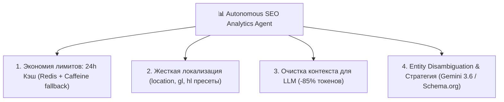

# 📊 Скилл: Автономный SEO Analytics Agent (Java / SerpApi / Redis / Gemini)

#agent-skills #seo-analytics #serpapi #caching #redis #caffeine #gemini #llm-optimization #localization #multilingual #schema-org

> **Назначение:** Архитектура, регламент и протокол работы автономного Java-агента для SEO-аналитики сайтов, аудита органической выдачи Google (SERP), анализа конкурентов и генерации стратегии продвижения через LLM.
> **Репозиторий:** [https://github.com/erythroai-droid/SEO-analytics](https://github.com/erythroai-droid/SEO-analytics)

---

## 1. 4 Столпа оптимизации агента (The 4 SEO Agent Pillars)



---

## 2. Архитектурные стандарты реализации

### 2.1. Двухуровневое кэширование (24h TTL)
- **Цель:** Исключение повторного расхода платной квоты SerpApi по частотным запросам.
- **L1 Cache:** In-Memory `Caffeine` (`expireAfterWrite(24h)`).
- **L2 Cache:** Распределенный `Redis` (Jedis) со сроком жизни ключа `86400 сек`.
- **Детерминированный ключ:** `SHA-256(engine + query + location + gl + hl + device + num)`.

### 2.2. Строгая локализация SERP
- Обязательная передача тройки параметров для каждого запроса:
  - `location`: Канонический гео-регион Google (например, `United States`, `Moscow, Russia`, `Israel`).
  - `gl`: Двухбуквенный код страны Google (`us`, `ru`, `il`, `de` и т.д.).
  - `hl`: Язык интерфейса (`en`, `ru`, `iw` для иврита, `de` и т.д.).
- Пресеты в enum `LocalizationPreset`: `US_EN`, `RU_RU`, `IL_HE`, `DE_DE`, `UK_EN`, `KZ_RU`.

### 2.3. Предобработка и сжатие данных перед LLM (Token Sanitizer)
- **Проблема:** Сырой JSON SerpApi содержит до 50–100 КБ служебного мусора (HTML-разметка, pagination, tracking URLs, base64-иконки).
- **Решение:** `SerpDataSanitizer` отбирает исключительно:
  - `organic_results`: позиция, title, чистый домен, snippet, sitelinks, rich snippet.
  - `answer_box`: featured snippet, прямой ответ, список тезисов.
  - `related_questions`: People Also Ask (PAA) вопросы и сниппеты.
  - `related_searches`: LSI-кластер поисковых запросов.
  - `knowledge_graph`: сущность, тип, атрибуты.
- **Эффект:** Снижение размера контекста на **75–90%**, мгновенный ответ нейросети (1–2 сек).

### 2.4. LLM Intelligence & Entity Disambiguation
- Поддержка нативного API **Google Gemini** (`gemini-3.6-flash`, `gemini-2.5-flash`) и OpenAI-совместимых эндпоинтов (Groq, DeepSeek, локальная Ollama).
- Выявление коллизий сущностей в Knowledge Graph (например, разделение IT-бренда `Erythro.ai` и медицинских терминов `erythrocyte`/`erythromycin`).
- Автоматическая генерация микроразметки Schema.org (`Organization`, `WebSite`, `sameAs` с привязкой GitHub и LinkedIn).

---

## 3. Регламент запуска и CLI/REST интерфейс

### Быстрый аудит через CLI
```bash
java -jar target/seo-analytics-agent-1.0.0.jar --query="best crm for startups" --domain="hubspot.com" --preset=US_EN
```

### Запуск REST API сервера (порт 8080)
```bash
java -jar target/seo-analytics-agent-1.0.0.jar
```

| Эндпоинт | Метод | Описание |
|---|---|---|
| `/api/seo/analyze` | `POST` | Полный аудит с выдачей структурированного JSON |
| `/api/seo/analyze/markdown` | `POST` | Генерация готового отчета в формате Markdown |
| `/api/seo/batch` | `POST` | Пакетный анализ кластера ключевых слов |
| `/api/seo/serp` | `GET` | Получение очищенного DTO поисковой выдачи |
| `/api/seo/presets` | `GET` | Список всех доступных пресетов локализации |
| `/api/seo/cache` | `DELETE` | Сброс кэша по указанному запросу и региону |

---

## 4. Конфигурация окружения (`.env`)

```env
# 1. SerpApi (парсинг Google SERP)
SERPAPI_KEY=your_serpapi_key

# 2. Google Gemini API (или OpenAI / Groq / Ollama)
GEMINI_API_KEY=your_gemini_key
LLM_MODEL=gemini-3.6-flash

# 3. Redis (опционально, при отсутствии используется Caffeine)
REDIS_HOST=localhost
REDIS_PORT=6379
```
