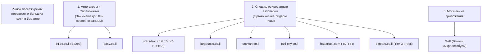

# Комплексный аудит и рыночная аналитика: BigCars.co.il

## 1. Резюме проекта (Executive Summary)

* **Домен:** `https://bigcars.co.il`
* **Специализация:** Сервис пассажирских перевозок на больших такси и микроавтобусах (от 5 до 25 мест), VIP-трансферы в аэропорт Бен-Гурион (נתב"ג), обслуживание мероприятий и корпоративные развозки по всему Израилю.
* **Технологический стек:** WordPress (PHP 8.1), Elementor, Yoast SEO, Link Whisper, Cloudflare CDN, Google Tag Manager (`GT-WB77JGBK` через Site Kit).
* **Контактные данные:** 03-381-5040, 08-881-4092, WhatsApp.
* **Ключевой диагноз:** Сайт обладает развитой посадочной структурой (85 страниц под города Израиля и вместимость автомобилей), но страдает от **критического недоиндекса в Google (индексировано всего 10 страниц из 85 — 11.7%)**, что полностью парализует органический трафик по большинству коммерческих гео-запросов. В органическом поиске по высокочастотным запросам сайт уступает агрегаторам (B144, Easy) и профильным конкурентам (Stars Taxi, LargeTaxis, TaxiVan).

---

## 2. Поисковая видимость: по каким запросам сайт выдается в поиске?

На основе прямого парсинга SERP (локация: Израиль, языки: `iw`, `ru`, `en`) с проверкой топ-20 Google выявлена следующая картина:

### 2.1. Брендовый трафик
* **`bigcars`** — **#1 место** (главная страница `https://bigcars.co.il`), а также занимает позиции **#3, #4, #7, #8** своими внутренними страницами (страница услуг, правила использования, такси в Нетании).
* **`"bigcars.co.il"`** — **#1 место** (плюс профили бренда на TikTok `@bigcars.co.il` и справочнике Easy на 2-3 позициях).
* **`big cars מוניות`** — **#6 место** в поисковой выдаче.
* **`ביג קארס`** — в топ-20 органики Google по запросу на иврите бренд вытесняется каталогами и общими авторесурсами.

### 2.2. Коммерческие и гео-запросы (Israel SERP)
* **`מונית גדולה ראשון לציון`** — **#5 место** в органической выдаче Google (страница `https://bigcars.co.il/מונית-גדולה-ראשון-לציון/`).
* **Остальные гео-запросы (Тель-Авив, Иерусалим, Герцлия, Хайфа, Петах-Тиква, Ашдод, Рамат-Ган, Нетания):**
  * Посадочные страницы созданы (например, `/מונית-גדולה-תל-אביב/`, `/מונית-גדולה-ירושלים/`), но **не входят в топ-20 Google**, так как большинство из них не попало в индекс Google.
* **Высокочастотные запросы по типу транспорта и аэропорту:**
  * `מונית גדולה` (Большое такси) — **Не ранжируется в топ-20** (выдачу занимают агрегаторы B144, Easy и Israel-Taxi).
  * `מונית גדולה לנתבג` (Большое такси в Бен-Гурион) — **Не ранжируется в топ-20** (лидеры: Stars Taxi, Hadar Lod, Derech LaSadeh).
  * `מונית לנתבג` — **Не ранжируется**.
  * `הסעות לנתבג` — **Не ранжируется**.
  * `מיניבוס לנתבג` — **Не ранжируется** (лидер: LargeTaxis).
  * Вместимость: `מונית גדולה 8 מקומות`, `מונית גדולה 6 מקומות`, `מונית 10 מקומות` — **Не ранжируются в топ-20**.

### 2.3. Запросы на русском языке
* `большое такси бен гурион`, `такси в аэропорт бен гурион микроавтобус`, `заказать большое такси израиль` — **Сайт полностью отсутствует в выдаче**, так как на сайте нет русскоязычной локализации (только `he-IL`). Рынок русскоязычных запросов занимают частные трансферные гиды, агрегаторы и сайты вроде ormax.co.il.

---

## 3. Рекламная активность (Google Ads & Social Media)

### 3.1. Google Search Ads (Контекстная реклама в поиске)
* **Активность BigCars:** Прямой рекламы Google Ads по проверенным 27 целевым запросам **не зафиксировано**.
* В исходном коде сайта отсутствуют теги Google Ads Remarketing / Conversion Tracking (`AW-...`).
* **Конкурентная активность в Google Ads:**
  * Ниша высококонкурентная, но рекламодатели выкупают показы в основном по коммерческим «горячим» запросам с высокой маржинальностью (вместимость 8+ мест, трансферы в аэропорт).
  * Активные рекламодатели в Google Ads:
    * **Gett (`www.gett.com/il/blog/order-large-vehicles/`)** — продвигает заказ вэнов и микроавтобусов через приложение.
    * **Champions Taxi (`champions-taxi.co.il`)** — активная кампания: *«מוניות גדולות לנתב"ג מכל הארץ - מונית גדולה לנתבג בכל שעה ביום»*.
    * **Easy.co.il** — продвигает внутренние платные листинги компаний.

### 3.2. Реклама в социальных сетях и SMM
* Бренд активно развивает видеомаркетинг в **TikTok** (`@bigcars.co.il`), контент генерирует органический интерес к бренду.
* Присутствует карточка компании в каталоге **Easy.co.il** (`easy.co.il/page/10126345`).
* **Пиксель Meta (Facebook/Instagram Pixel):** на сайте **не установлен** (отсутствует `connect.facebook.net` и `fbq('init')`). Это означает, что ретаргетинг на посетителей сайта и оптимизация рекламы по конверсиям на сайте не ведется. Лидогенерация из соцсетей ведется напрямую на звонки или переходы в мессенджеры.

---

## 4. Конкурентный анализ на локальном рынке Израиля

Рынок услуг «מוניות גדולות» (такси на 5–25 мест и трансферы) в Израиле четко сегментирован:

### Доли видимости в выдаче Google (SERP Share of Voice):
1. **Каталоги и агрегаторы:**
   * **`b144.co.il`** — появляется в топ-3 выдачи практически по 100% гео-запросов формата «מונית גדולה ב[עיר]».
   * **`easy.co.il`** — доминирует по запросам с намерениями поиска отзывов и рейтингов («מוניות גדולות הכי טובות»).
2. **Профильные лидеры-конкуренты:**
   * **`stars-taxi.co.il`** — органический лидер #1 по главному коммерческому запросу `מונית גדולה לנתבג`. Отличная структура посадочных страниц и высокая репутация.
   * **`largetaxis.co.il`** — занимает топ-1–топ-2 по запросам минибусов в аэропорт (`מיניבוס לנתבג`) и такси на 6 мест.
   * **`taxivan.co.il`** — удерживает топ-1 по запросам микроавтобусов `מונית 6 מקומות` и `מונית גדולה VIP`.
   * **`taxi-city.co.il`** — доминирует по городам округа Шарон (Герцлия, Раанана) и запросам `מונית 10 מקומות`.
   * **`biggestaxi.com`** — прямой конкурент в нише VIP-перевозок и больших такси.

### Какое место занимает BigCars среди конкурентов?
* **Позиция на рынке:** **Tier-3 / Нишевый игрок.**
* **Бренд:** Сайт успешно контролирует свой прямой брендовый трафик (`bigcars`), однако не имеет широкой узнаваемости на иврите по сравнению с Hadar Lod или Stars Taxi.
* **Органика:** Находится на начальном этапе органического масштабирования. Из-за проблем с индексацией сайт пока не конкурирует с лидерами на национальном уровне, хотя потенциал структуры посадочных страниц (85 URL) при правильной оптимизации способен вывести его в топ-3.

---

## 5. Технический аудит и критические ошибки сайта

### 5.1. Катастрофическая проблема индексации (Index Coverage Gap)
* В карте сайта (`sitemap_index.xml`) заявлено: **85 страниц**.
* Реально проиндексировано Google (`site:bigcars.co.il`): **ВСЕГО 10 СТРАНИЦ (11.7%)**.
* **Причина:** 75 гео-посадочных страниц созданы по шаблонному принципу без уникальной ценности. Поисковые алгоритмы Google (Helpful Content System / Doorway filters) определяют их как дублированный низкокачественный контент и не пускают в индекс.

### 5.2. Ошибки верстки и структуры заголовков (Heading Hierarchy Bug)
* На главной странице обнаружено **5 тегов H1** одновременно:
  1. `BIG CARS`
  2. `מונית גדולה ומיניבוס לנתב"ג ולכל הארץ`
  3. `1.` *(элемент верстки списка в Elementor ошибочно размечен как H1)*
  4. `2.` *(элемент верстки списка в Elementor)*
  5. `3.` *(элемент верстки списка в Elementor)*
* **Влияние:** Размывание семантического веса документа, нарушение стандартов доступности и ухудшение ранжирования главной страницы.

### 5.3. Оптимизация изображений и теги Alt
* На главной странице из 12 изображений **8 изображений (66.7%) не имеют заполненных атрибутов `alt`**.
* Потеря трафика из Google Images и снижение релевантности страницы.

### 5.4. Производительность и ресурсы
* Сайт перегружен фронтенд-библиотеками Elementor: подключено **25 внешних JavaScript-скриптов** и **29 CSS-таблиц стилей**.
* Отсутствует сквозное кэширование статики на уровне Cloudflare (возвращается `cf-cache-status: DYNAMIC`).

### 5.5. Аналитика и отслеживание конверсий
* Установлен контейнер Google Tag Manager `GT-WB77JGBK` (через плагин Google Site Kit).
* Отсутствуют микроразметки `LocalBusiness` / `TaxiService` со связкой рейтинга, отзывов и прайс-листа.
* Отсутствует Meta Pixel и интеграция с Google Ads Conversion API.

---

## 6. Стратегический план действий (Action Plan & Growth Roadmap)

### Этап 1: Неотложные технические исправления (Quick Wins — 1-2 недели)
1. **Исправление структуры H1:** В настройках виджетов Elementor на главной странице изменить теги нумерации `1.`, `2.`, `3.` с `H1` на `div` / `span`. Оставить единственный `H1`: `מונית גדולה ומיניבוס VIP לנתב״ג ולכל הארץ`.
2. **Устранение дефицита индексации (75 страниц):**
   * Добавить уникальный контент на посадочные страницы городов (расстояние от города до аэропорта Бен-Гурион, примерное время в пути, ориентировочная стоимость, популярные точки высадки).
   * Внедрить сквозной блок перелинковки в футере или на страницах услуг со списком всех обслуживаемых городов.
   * Настроить HTML-карту сайта.
3. **Заполнение Alt-тегов:** Прописать осмысленные ключевые фразы в тегах `alt` всех изображений автопарка (напр., *«מונית גדולה 8 מקומות מרצדס לנתבג»*).

### Этап 2: Локальное SEO и захват гео-трафика (2-4 недели)
1. **Google Business Profile (Google Карты):** Для служб такси и трансферов до 60% мобильного трафика забирает Local Pack (блок с картой и кнопкой вызова). Необходимо оформить и верифицировать профиль с категорией *Taxi Service / Transportation Service*, указать зоны обслуживания (Service Areas) по всем ключевым городам центра.
2. **Агрегаторы:** Усилить профиль на `easy.co.il` и `b144.co.il` (собрать реальные отзывы клиентов, заполнить все услуги и прайс-листы).

### Этап 3: Мультиязычная экспансия (Туризм и Репатриация)
* Запросы на трансферы в Бен-Гурион на **русском** и **английском** языках имеют высокую конверсию и меньшую конкуренцию среди местных израильских сайтов такси.
* Внедрение подпапок `/ru/` и `/en/` с посадочными страницами (*«Большое такси в аэропорт Бен-Гурион»*, *«Minibus to Ben Gurion Airport»*) позволит забрать до 25-35% дополнительного высокомаржинального трафика.

### Этап 4: Платный трафик (Google Ads & Meta)
* Запуск целевой поисковой кампании Google Ads с точным соответствием по фразам: `מונית גדולה 8 מקומות`, `מונית גדולה לנתבג מחיר`, `מיניבוס לנתבג`.
* Настройка отслеживания кликов по номеру телефона `03-381-5040` и переходов в WhatsApp как ключевых конверсий в Google Ads и GA4.
