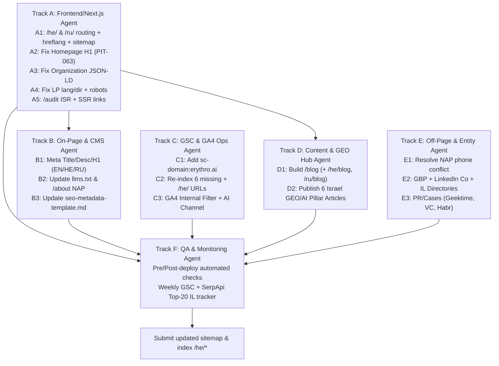

# Подробный план действий для агентов: SEO-рост `erythro.ai` в Израиле

> **Основание:** [erythro-ai-seo-audit-israel-2026-11-19.md](erythro-ai-seo-audit-israel-2026-11-19.md)  
> **Цель за 90 дней:** вывести `erythro.ai` с **0** до **15–25 коммерческих запросов в TOP 20 Google.co.il** (кластеры AI/GEO Audit, AI Automation, Next.js Web Dev на HE/EN/RU), закрепить **5+ брендовых запросов в TOP 3** (включая `erythro ai`, `erythro.ai` на иврите и `איריתרו`), достичь индексации **>95%** всех локализованных URL и **10–20+ органических лидов/мес** на бесплатный AI-аудит.

---

## 0. Карта потоков и порядок выполнения (Agent Orchestration DAG)

Работа разбита на **6 специализированных треков (агентов)**. Треки `A` и `C` стартуют **параллельно в день 1**; `B` синхронизируется с `A`; `D` и `E` могут идти параллельно после старта `A`; `F` выступает обязательным QA-гейтом перед и после каждого деплоя.



### Обязательные инженерные ограничения для всех агентов (Pitfalls)
Перед правками кода в `C:\dev\erythro-ai` каждый агент обязан соблюдать:
1. **PIT-024 (Edge Middleware):** `src/middleware.ts` работает в Edge Runtime — **запрещено** импортировать Payload CMS, `node:*` модули или БД. Использовать только лёгкие Edge-хелперы (как `markdownAccept.ts`).
2. **PIT-056 (ISR & `force-static`):** не вызывать `cookies()` / `headers()` в корневом `layout.tsx` и `not-found.tsx` для статических/ISR-страниц, иначе слетит `x-vercel-cache: HIT`. Локаль на `/he/*` и `/ru/*` должна определяться **из URL-сегмента `[locale]`**, а не из cookie/headers!
3. **PIT-063 (Desktop CLS в Hero):** при правке `<h1>` главной не возвращать GSAP `fontSize`-твины (использовать `scale` + фиксированный `min-h`).
4. **PIT-160 (React Hooks order):** любые хуки в клиентских компонентах (`AuditCalcFlow.tsx` и др.) объявлять строго выше ранних `return`.
5. **PIT-110 (Supabase RLS):** при создании новых коллекций Payload (например, `posts` для блога) проверить `has_table_privilege('anon', ...)` — публичный PostgREST-доступ к таблицам CMS должен оставаться закрытым.
6. **Логические свойства RTL:** на всех `/he/*` страницах использовать только `ps-*`, `pe-*`, `ms-*`, `me-*`, `start-*`, `end-*`, `text-start`, `rtl:rotate-180` (см. `01-Architecture/frontend-architecture.md`).

---

## 1. Track A — Frontend / Next.js Architecture Agent (`P0`, 5–7 дней)

* **Роль агента:** Senior Next.js 15 / Payload CMS / Technical SEO Engineer.
* **Рабочий репозиторий:** `C:\dev\erythro-ai`.
* **Главная задача:** устранить все технические SEO-блокеры, из-за которых Googlebot не видит ивритскую и русскую версии, не индексирует 33% страниц и получает искажённые сигналы сущности.

### Задача A1 — URL-based мультиязычность (`/he/`, `/ru/`, `/`) + `hreflang` + `sitemap.ts`
**Проблема:** сейчас `/he`, `/ru`, `/en` отдают `404`, а все 29 URL из `sitemap.xml` отдают Googlebot только `<html lang="en" dir="ltr">`. `hreflang` = `0`.

**Что реализовать:**
1. Ввести единую схему URL с префиксом для не-дефолтных локалей (`as-needed`):
   * Английский (`en`, default): `https://erythro.ai/...` (без префикса — сохраняем всю существующую историю и ссылки, 0 потерь при редиректах!).
   * Иврит (`he`): `https://erythro.ai/he/...` (`<html lang="he" dir="rtl">` + подключение шрифта `Heebo`).
   * Русский (`ru`): `https://erythro.ai/ru/...` (`<html lang="ru" dir="ltr">` + подключение `Inter Cyrillic`).
   * Редирект `301`: `/en` → `/` и `/en/:path*` → `/:path*` (чтобы не плодить дубли английской версии).
2. Архитектура в Next.js App Router (`src/app/(frontend)/`):
   * Ввести сегмент `[locale]` (или rewrite в `src/middleware.ts` для `/` → внутренний `/en/...` без редиректа в браузере, при условии строгого соблюдения `PIT-024` и `PIT-056`).
   * **Обязательно:** `generateStaticParams()` должен возвращать `[{ locale: 'en' }, { locale: 'he' }, { locale: 'ru' }]` для всех статических/ISR-страниц, чтобы Vercel отдавал `x-vercel-cache: HIT` для всех трёх языков без чтения cookie на сервере!
   * В `layout.tsx` устанавливать `<html lang={locale} dir={locale === 'he' ? 'rtl' : 'ltr'}>` **на сервере (SSR)** на основе `params.locale` — никаких переключений `lang`/`dir` только в `useEffect`!
   * Переключатель языков в хедере (`LanguageSwitcher`) должен выполнять навигацию на реальный URL выбранной локали (`router.push` / `<Link href>` на `/he/...`, `/ru/...`, `/...`), а не только менять клиентский state/cookie.
3. Двусторонний `hreflang` и `canonical` в `generateMetadata` каждой публичной страницы:
   * Создать единый хелпер `src/lib/seoAlternates.ts`:
     ```ts
     export function buildLocaleAlternates(pathname: string, locale: 'en' | 'he' | 'ru') {
       const siteUrl = 'https://erythro.ai'
       const clean = pathname === '/' ? '' : pathname.replace(/\/$/, '')
       const urls = {
         en: `${siteUrl}${clean || '/'}`,
         he: `${siteUrl}/he${clean}`,
         ru: `${siteUrl}/ru${clean}`,
       }
       return {
         canonical: urls[locale],
         languages: {
           'en': urls.en,
           'he-IL': urls.he,
           'ru': urls.ru,
           'x-default': urls.en,
         },
       }
     }
     ```
   * Также выставлять корректный `openGraph.locale` (`en_US` / `he_IL` / `ru_RU`) и `openGraph.alternateLocale`.
4. Обновить `src/app/sitemap.ts`:
   * Генерировать все 3 языковые версии для каждой из 29 публичных страниц (**87 URL**), используя формат `alternates.languages` Next.js Sitemap API (`xhtml:link rel="alternate" hreflang="..."`) для каждого `<url>`.
   * Не включать `/admin`, `/api/*`, `/lp/*`, `/audit/report/*`.
5. Обновить `FAQPage` и `Service` JSON-LD:
   * Убедиться, что на `/he/...` JSON-LD отдаёт `"inLanguage": "he"` и ивритский текст FAQ/услуг (SSR), а на `/ru/...` — `"inLanguage": "ru"` и русский текст.

**Definition of Done (A1):**
- `curl -s https://erythro.ai/he` → `HTTP 200`, `<html lang="he" dir="rtl">`, ивритский `<title>`, `<h1>`, текст и `<link rel="canonical" href="https://erythro.ai/he">`.
- `curl -s https://erythro.ai/ru` → `HTTP 200`, `<html lang="ru" dir="ltr">`, русский контент и `canonical`.
- `curl -s https://erythro.ai/en` → `HTTP 301` на `https://erythro.ai/`.
- На всех 3 версиях присутствуют все 4 тега `hreflang`: `en`, `he-IL`, `ru`, `x-default`.
- `https://erythro.ai/sitemap.xml` содержит ~87 URL с валидным XML и `xhtml:link`.
- `x-vercel-cache: HIT` сохраняется на `/`, `/he`, `/ru`, `/services/*`, `/he/services/*`.

---

### Задача A2 — Исправление `<h1>` главной страницы (`/`, `/he`, `/ru`)
**Проблема:** в текущем DOM главной страницы внутри `<h1>` лежит невидимый русский spacer `<span aria-hidden="true" class="invisible">МАСШТАБИРУЕМЫЕ СИСТЕМЫ</span>`, склеивающийся с `ENGINEERING FUTURE`. Итог: смешанный язык в `<h1>` на `lang="en"` и **0 коммерческих ключевых слов**.

**Что реализовать:**
1. Вынести расчёт высоты/ширины под анимацию в CSS (`min-h-[...]`) или `data-*` / отдельный `div` **вне** тега `<h1>`, полностью удалив текст другой локали из HTML.
2. Задать в `<h1>` релевантные, коммерчески сильные заголовки (при желании декоративный слоган `ENGINEERING FUTURE` оставить как `<p>` kicker/eyebrow над или под `<h1>`, чтобы не ломать визуальную эстетику):
   * **EN (`/`):** `AI Website Audit, Automation & Enterprise Web Development in Israel` *(или компактно для Hero: `Enterprise Web Development, AI Agents & GEO Audit`)*
   * **HE (`/he`):** `בניית אתרים מתקדמים, אוטומציה עסקית וביקורת AI/GEO בישראל`
   * **RU (`/ru`):** `Разработка сайтов на Next.js, AI-автоматизация и аудит в Израиле`
3. Сохранить `CLS < 0.05` (проверить в Lighthouse / Playwright по `PIT-063`).

**Definition of Done (A2):**
- На `/` в `<h1>` **нет кириллицы** (`has_cyrillic` в `<h1>` = `false`).
- На каждой локали строго **один** видимый `<h1>` на языке этой локали с коммерческими ключевыми словами.
- Desktop & Mobile CLS не ухудшились (`< 0.05`).

---

### Задача A3 — Исправление `Organization` JSON-LD и Entity Graph (`src/lib/brandSchema.ts`)
**Проблема:** `"founder": {"name": "Founder"}` (заглушка!), в `sameAs` отсутствуют Instagram и YouTube (которые уже #2 и #4–5 в выдаче по бренду), Facebook указан через временную share-ссылку.

**Что реализовать в `src/lib/brandSchema.ts`:**
1. Исправить `founder`:
   ```json
   "founder": {
     "@type": "Person",
     "@id": "https://erythro.ai/#founder",
     "name": "Vadym Kovalenko",
     "jobTitle": "Founder & Lead Architect",
     "url": "https://www.linkedin.com/in/erythro-ai",
     "sameAs": [
       "https://www.linkedin.com/in/erythro-ai",
       "https://github.com/erythroai-droid"
     ]
   }
   ```
2. Обновить `sameAs` у `Organization`:
   * Добавить `https://www.instagram.com/erythro.ai/`
   * Добавить канонический URL YouTube-канала Erythro.ai
   * Заменить `https://www.facebook.com/share/1DKaM3k5ox/` на постоянный канонический URL Facebook-страницы
   * После создания LinkedIn Company Page (Track E) добавить `https://www.linkedin.com/company/erythro-ai` (плюс `Clutch`, `Crunchbase`, `Easy.co.il`).
3. Расширить `areaServed` и `knowsAbout`:
   * В `areaServed` оставить `Israel` (и добавить `Tel Aviv`, `Jerusalem`, `Haifa`, `Eilat` или `Country: Israel` + `Global`).
   * Добавить `"knowsAbout": ["Generative Engine Optimization (GEO)", "AI Website Audit", "Next.js Web Development", "AI Agents & Business Automation", "Conversion Rate Optimization (CRO)"]` — это помогает Google Entity Graph отделить `Erythro.ai` от медицинского термина *erythrocytes / erythromycin*.
4. Проверить и обновить `tests/int/brandSchema.int.spec.ts`.

**Definition of Done (A3):**
- Валидация JSON-LD через Schema Validator / Rich Results Test без ошибок.
- `"name": "Vadym Kovalenko"` и `instagram.com/erythro.ai` присутствуют в SSR HTML.
- Все юнит/интеграционные тесты `brandSchema.int.spec.ts` зелёные.

---

### Задача A4 — Исправление HTML-атрибутов и `robots` на рекламных лендингах (`leak-*`, `audit-*`, `/lp/*`)
**Проблема:** на `https://leak-he.erythro.ai/`, `https://audit-he.erythro.ai/` и `https://erythro.ai/lp/audit/he` в SSR HTML стоит `<html lang="en" dir="ltr">`, хотя страница полностью на иврите; одновременно в HTML стоит `<meta name="robots" content="index, follow">`, а в HTTP-заголовке `X-Robots-Tag: noindex, nofollow`.

**Что реализовать:**
1. На всех ивритских лендингах (`leak-he`, `audit-he`, `/lp/audit/he`) отдавать с сервера `<html lang="he" dir="rtl">` (на `audit-ru`, `/lp/audit/ru` — `<html lang="ru" dir="ltr">`).
2. Синхронизировать директивы индексации для PPC-лендингов: если лендинги намеренно закрыты от индекса (`X-Robots-Tag: noindex, nofollow`), выставить в `metadata.robots = { index: false, follow: false }` вместо конфликтующего `index, follow`.
3. На `/lp/audit/{en,he,ru}` проверить `canonical` — сейчас он указывает на `audit-{en,he,ru}.erythro.ai` (которые `noindex`). Убедиться, что `/lp/audit/*` также не индексируются и не конкурируют с органическими `/audit`, `/he/audit`, `/ru/audit`.

**Definition of Done (A4):**
- `curl -sI https://leak-he.erythro.ai/` и HTML: `lang="he" dir="rtl"`, `robots: noindex, nofollow` согласованы без конфликтов.
- Не сломан message match и `AuditCalcFlow.tsx` (`PIT-160`).

---

### Задача A5 — Устранение недоиндекса (6 URL) и оптимизация TTFB / ISR для `/audit`
**Проблема:**
1. 6 страниц из `sitemap.xml` не в индексе Google: `/services/management`, `/portfolio/ai-consultant`, `/portfolio/ai-audit-agent`, `/portfolio/ember`, `/portfolio/ora-60a`, `/portfolio/rosso-garage`.
2. `/audit` отдаётся с `Cache-Control: private, no-cache, no-store` (`x-vercel-cache: MISS`), TTFB ~945–1560 ms на большинстве страниц.

**Что реализовать:**
1. Проверить SSR-перелинковку (HTML без JS):
   * Убедиться, что на `/`, `/he`, `/ru` в `<nav>`, `<footer>` и блоках услуг/кейсов присутствуют прямые `<a href="...">` на **все 5 услуг** (включая `/services/management`) и **все опубликованные кейсы** (особенно `/portfolio/ai-consultant` и `/portfolio/ai-audit-agent`, желательно вывести их в топ сетки на `/portfolio` и на `/services/ai-automation`).
   * Добавить блок «Связанные кейсы» на страницах услуг и «Связанная услуга + Бесплатный аудит» внизу каждого кейса (усиливаем внутренний PageRank и глубину обхода).
2. Перевести оболочку `/audit` (и `/portfolio/[slug]`, см. `PLAN-deferred.md`) на ISR (`force-static` + `revalidate = 60` + клиентская гидрация формы/результатов по паттерну `PIT-056`), чтобы `https://erythro.ai/audit` и `/he/audit` отдавали `x-vercel-cache: HIT` и TTFB `< 300 ms`.
3. Проверить, что в `robots.txt` и `middleware.ts` нет лишних редиректов/задержек.

**Definition of Done (A5):**
- Все 6 ранее неиндексированных URL присутствуют в SSR `<a href>` с главной / `/portfolio` / `/services/*`.
- Повторный `curl -sI https://erythro.ai/audit` и `/he/audit` возвращает `x-vercel-cache: HIT` и TTFB `< 350 ms`.

---

## 2. Track B — On-Page SEO & Payload CMS Content Agent (`P0 / P1`, 3–4 дня)

* **Роль агента:** SEO Copywriter & CMS Operations Agent (EN / HE / RU).
* **Рабочая зона:** Payload CMS (`erythro.ai/admin`), `src/lib/pageFaq.ts`, `public/llms.txt`, `D:\Obsidian\Knowledge-Base\04-Templates\seo-metadata-template.md`.
* **Главная задача:** привести все `Title` (строго **50–60 символов**), `Meta Description` (**140–155 символов**) и `H1` к коммерческому поисковому спросу Израиля на 3 языках.

### Задача B1 — Готовая матрица Title / Description для ключевых страниц (EN / HE / RU)

> **Правило длины:** не превышать 60 симв. в Title (иначе Google обрезает бренд/УТП) и 155 симв. в Description. Вставлять гео-якорь (`Israel` / `ישראל` / `Израиль`) и целевой коммерческий ключ в начало Title.

| Страница | Локаль | Целевой Title (50–60 симв.) | Целевой Meta Description (140–155 симв.) |
| :--- | :---: | :--- | :--- |
| **`/`** | `en` | `Erythro.ai — Web Development, AI Agents & GEO Audit Israel` | `B2B digital agency in Israel. Custom Next.js websites, autonomous AI agents, and free AI & GEO website audits to capture leads in Google & ChatGPT.` |
| **`/he`** | `he` | `בניית אתרים מתקדמים, אוטומציה וביקורת AI בישראל \| Erythro.ai` | `סוכנות דיגיטל ופיתוח בישראל: בניית אתרי Next.js מהירים, סוכני AI לעסקים וביקורת אתר חינם לנראות בגוגל וב-ChatGPT. שירות לכל הארץ.` |
| **`/ru`** | `ru` | `Разработка сайтов, AI-агенты и аудит в Израиле \| Erythro.ai` | `Цифровое агентство в Израиле: сайты на Next.js, AI-автоматизация бизнеса и бесплатный AI/GEO-аудит сайта для роста заявок из Google и ChatGPT.` |
| **`/audit`** | `en` | `Free AI Website Audit: SEO, CRO & GEO Score \| Erythro.ai` | `Run a free AI website audit in Israel. Check PageSpeed, CRO lead leaks, SEO, and visibility in ChatGPT & Perplexity with a 0–100 score and fix plan.` |
| **`/he/audit`** | `he` | `ביקורת אתר AI חינם: בדיקת SEO, GEO והמרות \| Erythro.ai` | `בדיקת אתר חינמית עם AI: קבלו ציון 0–100 על מהירות, SEO, יחס המרה (CRO) ונראות ב-ChatGPT ו-Perplexity + 3 הסיכונים המרכזיים באתר שלכם.` |
| **`/ru/audit`** | `ru` | `Бесплатный AI-аудит сайта: SEO, CRO и GEO \| Erythro.ai` | `Проверьте сайт бесплатно: скорость, SEO, утечки конверсии (CRO) и видимость в ChatGPT и Perplexity. Получите оценку 0–100 и план исправлений.` |
| **`/services/ai-automation`** | `en` | `AI Automation & Custom AI Agents in Israel \| Erythro.ai` | `Business process automation in Israel: custom AI agents, WhatsApp/CRM bots, RAG assistants & n8n workflows that qualify leads and cut manual ops.` |
| **`/he/services/ai-automation`** | `he` | `אוטומציה עסקית וסוכני AI לעסקים בישראל \| Erythro.ai` | `הטמעת סוכני AI ואוטומציה עסקית בישראל: צ'אטבוטים חכמים ל-WhatsApp ו-CRM, תהליכי n8n ואינטגרציות שחוסכות זמן ומגדילות מכירות.` |
| **`/ru/services/ai-automation`** | `ru` | `AI-автоматизация бизнеса и ИИ-агенты в Израиле \| Erythro.ai` | `Внедрение AI-агентов и автоматизация процессов в Израиле: боты для WhatsApp и CRM, RAG-ассистенты и сценарии n8n под ключ.` |
| **`/services/development`** | `en` | `Next.js & Custom Web Development in Israel \| Erythro.ai` | `High-performance Next.js, TypeScript & Java Spring Boot web development in Israel. PageSpeed 95+, native RTL Hebrew support, SEO & GEO architecture.` |
| **`/he/services/development`** | `he` | `בניית אתרים מתקדמים ב-Next.js ופיתוח מותאם \| Erythro.ai` | `בניית אתרים לעסקים בישראל בטכנולוגיית Next.js ו-Spring Boot. ביצועים 95+, תמיכת RTL מלאה, קידום SEO ו-GEO וממשק ניהול מותאם אישית.` |
| **`/ru/services/development`** | `ru` | `Создание сайтов на Next.js и веб-разработка в Израиле` | `Разработка быстрых B2B-сайтов и веб-приложений в Израиле на Next.js и Spring Boot. PageSpeed 95+, RTL-иврит, SEO и интеграция с CRM.` |
| **`/services/enterprise-engineering`** | `en` | `Enterprise Software & High-Load Backend Israel \| Erythro.ai` | `Full-stack enterprise engineering in Israel: Java Spring Boot, Next.js, PostgreSQL, OAuth2/PKCE security, and scalable AI integrations with 24/7 SLA.` |
| **`/he/services/enterprise-engineering`** | `he` | `פיתוח מערכות ארגוניות ו-Backend בעומס גבוה \| Erythro.ai` | `הנדסת תוכנה ארגונית בישראל: Java Spring Boot, Next.js, אבטחת OAuth2 ואינטגרציות AI ומערכות עומס גבוה עם תמיכת SLA 24/7.` |
| **`/services/design-branding`** | `en` | `Web Design, UI/UX & Brand Identity in Israel \| Erythro.ai` | `B2B web design, Figma UI/UX systems, motion design & brand identity in Israel. Conversion-focused interfaces built for Hebrew RTL and global markets.` |
| **`/he/services/design-branding`** | `he` | `עיצוב אתרים UI/UX ומיתוג עסקי בישראל \| Erythro.ai` | `עיצוב אתרים ממירים, מערכות UI/UX ב-Figma, מיתוג עסקי ואנימציות מותאמות ל-RTL בעברית. עיצוב פרימיום שמביא לידים לעסקים בישראל.` |
| **`/services/management`** | `en` | `Website Maintenance, SLA & DevOps Management \| Erythro.ai` | `Ongoing website management, Cloudflare security, Payload CMS admin, Core Web Vitals monitoring & 24/7 SLA support for B2B sites in Israel.` |
| **`/he/services/management`** | `he` | `ניהול אתרים, תחזוקה ותמיכת SLA לעסקים \| Erythro.ai` | `תחזוקת אתרים, אבטחת Cloudflare, ניהול תוכן, ניטור ביצועים ותמיכת SLA 24/7 לאתרים ומערכות עסקיות בישראל.` |
| **`/portfolio`** | `en` | `Portfolio: Next.js Sites & AI Agent Case Studies \| Erythro.ai` | `Explore Erythro.ai case studies: AI Website Auditor, Gemini AI Consultant, e-commerce & scroll-motion Next.js sites with 90+ PageSpeed scores.` |
| **`/he/portfolio`** | `he` | `תיק עבודות: אתרי Next.js ופרויקטי AI \| Erythro.ai` | `צפו בפרויקטים של Erythro.ai: מערכת ביקורת אתרים ב-AI, יועץ AI חכם, חנויות אונליין ואתרי תדמית מהירים עם ביצועי PageSpeed 90+.` |
| **`/about`** | `en` | `About Erythro.ai — Digital & AI Agency in Israel` | `Official brand facts about Erythro.ai, founded by Vadym Kovalenko in Israel. Serving Tel Aviv, Eilat & global B2B clients in EN, HE, and RU.` |
| **`/contacts`** | `en` | `Contact Erythro.ai — Web & AI Agency in Israel` | `Contact Erythro.ai for a free AI website audit, custom Next.js project or AI automation. Serving all of Israel (Tel Aviv, Haifa, Jerusalem, Eilat).` |

*Для всех страниц `/order/*` и `/portfolio/*` также сократить Title до `≤ 60 симв.` и Description до `≤ 155 симв.` и добавить переводы на `HE` и `RU`.*

### Задача B2 — Обновление `public/llms.txt` и `/about`
1. Проверить и синхронизировать единые контакты (NAP): телефон **`+972-50-530-8305`**, email **`team@erythro.ai`** / **`order@erythro.ai`**, география: *Headquartered in Eilat, Israel; serving clients nationwide across Israel (Tel Aviv, Herzliya, Haifa, Jerusalem) and globally*.
2. Добавить в `public/llms.txt` ссылки на `/he`, `/he/audit`, `/he/services/ai-automation`, `/ru`, имя основателя (`Vadym Kovalenko`), Instagram (`@erythro.ai`) и YouTube.

### Задача B3 — Актуализация шаблона в базе знаний
Обновить [seo-metadata-template.md](file:///D:/Obsidian/Knowledge-Base/04-Templates/seo-metadata-template.md): убрать устаревший паттерн `?lang=en|ru|he` и заменить его на path-based `buildLocaleAlternates` (`/`, `/he/...`, `/ru/...` + `x-default`).

**Definition of Done (Track B):**
- 100% из 87 URL (`29 × 3`) имеют уникальные Title (45–60 симв.), Description (120–155 симв.) и локализованный `H1`.
- В `crawl_results` нет страниц с `title_len > 65` или `desc_len > 160` на основных коммерческих URL.

---

## 3. Track C — Analytics & Search Console Ops Agent (`P0`, 1–2 дня)

* **Роль агента:** Web Analytics & Search Console Operations Specialist.
* **Рабочая зона:** Google Search Console, Google Analytics 4 (`properties/543568002`), Cloudflare DNS.

### Задача C1 — Domain Property в GSC
1. Создать в Google Search Console новый ресурс типа **Domain Property**: `sc-domain:erythro.ai`.
2. Верифицировать через DNS TXT-запись в Cloudflare.
3. Выдать права сервисному аккаунту/пользователю MCP, чтобы будущие аудиты автоматически видели и основной домен, и все поддомены (`leak-*`, `audit-*`, `ember.*`, `ora60a.*`, `la-scala.*`, `mustang.*`).

### Задача C2 — Индексация выпавших и новых локализованных URL
1. Сразу после деплоя Track A + B:
   * Повторно отправить `https://erythro.ai/sitemap.xml` в GSC.
   * Через GSC URL Inspection вручную запросить индексацию (`Request Indexing`) для 6 выпавших URL:
     1. `https://erythro.ai/services/management`
     2. `https://erythro.ai/portfolio/ai-consultant`
     3. `https://erythro.ai/portfolio/ai-audit-agent`
     4. `https://erythro.ai/portfolio/ember`
     5. `https://erythro.ai/portfolio/ora-60a`
     6. `https://erythro.ai/portfolio/rosso-garage`
   * Затем запросить индексацию для 6 приоритетных ивритских страниц: `/he`, `/he/audit`, `/he/services/ai-automation`, `/he/services/development`, `/he/services/design-branding`, `/he/portfolio`.

### Задача C3 — Чистка и настройка GA4 (`properties/543568002`)
1. **Internal Traffic Filter:** в GA4 Admin → Data Streams → Configure tag settings → Define internal traffic добавить IP офиса/команды + активировать фильтр в Data Filters (`Testing` → `Active`), чтобы исключить искажение Organic Search (сейчас 6 пользователей команды генерируют 127 сессий по 18.5 мин).
2. **Unwanted Referrals:** добавить `localhost`, `127.0.0.1`, `tagassistant.google.com` в List Unwanted Referrals.
3. **AI Referral Channel Group:** создать кастомную группу каналов (или правило в Channel Groups) для `Source matches regex`: `(chatgpt\.com|chat\.openai\.com|perplexity\.ai|claude\.ai|gemini\.google\.com|copilot\.microsoft\.com)` (см. `AI_VISIBILITY.md` и `src/lib/aiReferral.ts`).
4. **Key Events (Conversions):** проверить, что отправка формы аудита (`audit_submit` / `generate_lead`), клик WhatsApp и заявка с `/contacts` помечены как Key Events и корректно атрибутируются к `Organic Search`.

**Definition of Done (Track C):**
- `sc-domain:erythro.ai` подтверждён и собирает данные.
- Все 12 приоритетных URL отправлены на индексацию, через 7–14 дней `index_inspect` возвращает `PASS` для 6/6 ранее отсутствовавших URL.
- В GA4 активирован Internal Traffic Filter, настроены Unwanted Referrals и AI Referral Channel.

---

## 4. Track D — Content & GEO Hub Agent (`P1 / P2`, недели 2–8)

* **Роль агента:** Technical Content Strategist & GEO/SEO Editor (HE / EN / RU).
* **Рабочая зона:** `C:\dev\erythro-ai` (модуль блога) + Payload CMS.
* **Почему это критично:** у `erythro.ai` всего 29 коммерческих/служебных страниц. В Израиле по ключевым запросам `קידום אתרים geo`, `קידום אתרים במנועי ai`, `בדיקת אתר ai`, `ai visibility audit` в Top 5 ранжируются именно **экспертные гайды и статьи** (`websight.co.il/he/seo-geo-guide/`, `seotitles.co.il`, `eyefulmedia.com`, `hashmeta.com`), а **на 100% проверенных запросов показывается Google AI Overview**.

### Задача D1 — Архитектура контент-хаба `/blog` (Next.js + Payload CMS)
1. Добавить коллекцию `posts` в Payload CMS (локализованные поля `en`, `he`, `ru`: `title`, `slug`, `excerpt`, `content`, `seoTitle`, `seoDescription`, `faqItems`, `author` → `Vadym Kovalenko`, `publishedAt`, `updatedAt`, `coverImage`, `relatedService`, `category`).
2. Маршруты: `/blog`, `/blog/[slug]`, `/he/blog`, `/he/blog/[slug]`, `/ru/blog`, `/ru/blog/[slug]` с ISR (`revalidate = 300`), `hreflang`, добавлением в `sitemap.ts` и проверкой RLS (`PIT-110`).
3. Structured Data на каждой статье:
   * `Article` / `BlogPosting` с `author` (`@id: https://erythro.ai/#founder`), `publisher` (`@id: https://erythro.ai/#organization`), `datePublished`, `dateModified`, `inLanguage`.
   * `BreadcrumbList` (`Home → Blog → Post`).
   * `FAQPage` (3–5 вопросов под People Also Ask и AI Overviews).
4. **Конверсионная обвязка:** в середине и конце каждой статьи встроенный CTA-виджет «Проверьте ваш сайт на SEO & AI Visibility за 60 секунд» → ссылка на `/he/audit` / `/audit` / `/ru/audit` с UTM/event-трекингом.

### Задача D2 — Контент-план первых 6 Pillar-статей (высокий интент, низкая конкуренция в Израиле)

> **Стандарт GEO/AIO-оптимизации для каждой статьи:** первый абзац сразу после H1 — прямой чёткий ответ (40–60 слов, идеальный блок для цитирования в AI Overview и ChatGPT); таблицы сравнений; конкретные цифры/чек-листы из практики Erythro.ai; блок FAQ в конце; 3–5 внутренних ссылок на `/audit`, `/services/*` и кейсы.

| # | Локали | Целевые запросы (IL) | Заголовок статьи | Цель и внутренняя перелинковка |
| :---: | :---: | :--- | :--- | :--- |
| **1** | `HE` + `EN` | `קידום אתרים geo`, `קידום אתרים במנועי ai`, `geo optimization agency israel` | **HE:** מדריך קידום אתרים במנועי AI (GEO) בישראל 2026–2027<br>**EN:** Generative Engine Optimization (GEO) in Israel: Complete 2026 Guide | Захват низкоконкурентного GEO-кластера → CTA на `/he/audit`, `/audit` |
| **2** | `HE` + `EN` | `בדיקת אתר ai`, `בדיקת נראות ב-chatgpt`, `ai visibility audit` | **HE:** איך לבדוק נראות אתר ב-ChatGPT, Perplexity ו-Google AI Overview<br>**EN:** How to Audit Your Website's AI Visibility in ChatGPT & Perplexity | Коммерческий мостик к инструменту бесплатного аудита → `/he/audit`, `/portfolio/ai-audit-agent` |
| **3** | `HE` + `EN` | `llms.txt`, `schema.org לעסקים`, `ai readiness audit` | **HE:** המדריך הטכני ל-llms.txt, Schema.org ו-AI Crawlers לאתרים בישראל<br>**EN:** Technical AI Readiness Checklist: llms.txt, MCP, Schema & Robots.txt | Демонстрация экспертизы (у Erythro.ai это уже внедрено в прод!) → `/about`, `/audit` |
| **4** | `HE` + `RU` | `אוטומציה עסקית ai`, `סוכני ai לעסקים`, `ai автоматизация бизнеса израиль` | **HE:** אוטומציה עסקית עם סוכני AI ו-WhatsApp בישראל: עלויות ו-ROI<br>**RU:** AI-автоматизация бизнеса в Израиле (WhatsApp, CRM, n8n): цены и ROI | Лиды на пакеты автоматизации → `/he/services/ai-automation`, `/order/business-automation`, `/portfolio/ai-consultant` |
| **5** | `HE` + `EN` + `RU` | `בניית אתרים ai`, `next.js agency israel`, `создание сайтов израиль` | **HE:** Next.js מול WordPress לבניית אתר עסקי בישראל: מהירות, SEO ו-RTL<br>**EN:** Next.js vs WordPress for Israeli B2B Sites: Speed, RTL & SEO | Лиды на разработку → `/he/services/development`, `/portfolio/rosso-garage` |
| **6** | `HE` + `EN` | `שיפור יחס המרה`, `בדיקת קידום אתרים`, `website audit israel` | **HE:** למה אתרים בישראל מאבדים לידים? 7 כשלי CRO ומהירות נפוצים<br>**EN:** Why Israeli B2B Websites Lose Leads: 7 CRO & Speed Leaks | Синергия с Google Ads (`leak-*`) → `/he/audit`, `/audit` |

**Definition of Done (Track D):**
- Опубликовано 6 статей (минимум 12 URL на `HE` + `EN`, опционально + `RU`), каждая 1 500–2 500 слов, с валидной `Article` + `FAQPage` + `BreadcrumbList` Schema.
- Все статьи попали в `sitemap.xml`, проиндексированы в GSC (`PASS`) и имеют сквозные ссылки на `/audit` и `/services/*`.

---

## 5. Track E — Off-Page, Entity & Local Israel SEO Agent (`P1 / P2`, недели 1–8)

* **Роль агента:** Digital PR, Local SEO & Entity Building Agent.
* **Справочная база:** [brand-entity-promotion.md](file:///D:/Obsidian/Knowledge-Base/01-Architecture/brand-entity-promotion.md).
* **Главная задача:** разорвать коллизию бренда с медицинским *erythromycin* (`clalit.co.il`) и стоками *erythrocytes*, вывести `erythro ai`, `erythro.ai` (`hl=iw`) и `איריתרו` в TOP 3 Израиля и нарастить траст домена (DR/локальные ссылки).

### Задача E1 — Срочное устранение конфликта NAP (до любых регистраций!)
> **Обнаружено при аудите:** на боевом сайте `erythro.ai` (`/contacts`, JSON-LD) указан телефон **`+972 50 530 8305`**, а в документе `brand-entity-promotion.md` (§3.1) указан **`+972 50 931 27 46`**!
1. Подтвердить с владельцем единственный канонический номер телефона и email (`team@erythro.ai` vs `order@erythro.ai`).
2. Обновить `brand-entity-promotion.md`, `llms.txt`, `/contacts`, `/about` и `brandSchema.ts`, чтобы NAP был **100% идентичен** везде.

### Задача E2 — Приоритетные регистрации (Entity & Israel Local Citations)
Выполнить в строгом порядке приоритета (с единым NAP, логотипом, описаниями на HE/EN и ссылкой на `https://erythro.ai/` или `https://erythro.ai/he`):
1. **Google Business Profile (критично для Израиля!):**
   * Название: `Erythro.ai — פיתוח אתרים ואוטומציה ב-AI` (или `Erythro.ai`)
   * Основная категория: `Software Company` / `Website Designer` + доп. `Internet Marketing Service`
   * Регион обслуживания (Service Area): **весь Израиль** (Tel Aviv, Herzliya, Haifa, Jerusalem, Eilat) — не ограничиваться только Эйлатом.
   * Заполнить услуги (HE + EN), FAQ, добавить 5+ скриншотов кейсов, ссылку на `/he/audit`.
   * Собрать первые **5–10 реальных отзывов** от клиентов/партнёров с упоминанием *Erythro AI / בניית אתרים / אוטומציה / ביקורת אתר*.
2. **LinkedIn Company Page (`linkedin.com/company/erythro-ai`):**
   * Сейчас в выдаче есть только личный профиль основателя (`in/erythro-ai`), корпоративной страницы нет.
   * Привязать опыт Vadym Kovalenko к Company Page, регулярно публиковать анонсы статей из Track D со ссылками на `erythro.ai`.
3. **Ключевые B2B-каталоги, которые УЖЕ ранжируются в TOP 5 Израиля по нашим запросам:**
   * **TechBehemoths** *(сейчас #2 по `next.js agency israel`!)* — оформить полный профиль в категориях Next.js, AI Automation, Web Development, Israel.
   * **Easy.co.il** *(сейчас #1 по `custom web development agency israel`!)* — создать ивритскую карточку компании.
   * **Clutch.co** & **GoodFirms** & **Crunchbase** — заполнить профили с фокусом на Israel, Next.js, AI Agents, GEO Audit.
   * **B144.co.il** — базовая локальная карточка Израиля.
4. **Оптимизация уже ранжирующихся профилей бренда:**
   * Instagram `@erythro.ai` (#2 в выдаче) и YouTube-канал (#4–5): добавить в описания ключевые фразы `Erythro AI` (с пробелом!), `Erythro.ai`, `איריתרו`, `ישראל`, ссылки на `https://erythro.ai/he/audit` и `https://erythro.ai/audit`.
   * После создания всех профилей передать список URL агенту Track A для добавления в `sameAs` (`brandSchema.ts`).

### Задача E3 — Внешние публикации / Digital PR (недели 4–8)
Опубликовать 3–4 экспертные статьи/кейса с естественными ссылками (`Erythro.ai`, `Erythro AI`, анкор на `/audit` и `/he/blog/...`):
* Израильские площадки (HE/EN): **Geektime**, **LinkedIn Articles** (от имени основателя на HE и EN), профильные израильские AI/Marketing сообщества.
* Русскоязычный tech-сегмент: **Habr** и **VC.ru** (готовые темы уже описаны в `brand-entity-promotion.md` §2).
* **Product Hunt Launch** для бесплатного инструмента **Erythro AI Website Auditor (`erythro.ai/audit`)** — даст мощный всплеск трастовых ссылок, упоминаний бренда `Erythro AI` и трафика.

**Definition of Done (Track E):**
- NAP унифицирован во всех источниках.
- Верифицирован Google Business Profile + созданы минимум 6 профилей (`LinkedIn Company`, `Easy.co.il`, `TechBehemoths`, `Clutch`, `Crunchbase`, `B144`), все URL добавлены в `sameAs`.
- Опубликовано ≥ 2 внешних экспертных материала и запущен Product Hunt для `/audit`.

---

## 6. Track F — QA, Verification & SEO Monitoring Agent (`Continuous`)

* **Роль агента:** Automated QA & SEO Telemetry Agent.
* **Рабочая зона:** `c:\agents\SEO-analytics` (SerpApi) + GSC MCP + GA4 MCP + Playwright/curl.

### Задача F1 — Обязательный Post-Deploy QA чек-лист (после Track A + B)
Агент F запускает автоматическую проверку на проде и **не принимает релиз**, если провален любой пункт:
1. **HTTP & Редиректы:** все ~87 URL из `sitemap.xml` отвечают `200 OK`; `/en` → `301 /`; `http://` и `www.` → `301 https://erythro.ai/`.
2. **Локализация SSR:**
   * `/he/*` содержит `<html lang="he" dir="rtl">`, ивритский `<title>`, `<h1>`, текст и `FAQPage` (`"inLanguage": "he"`).
   * `/ru/*` содержит `<html lang="ru" dir="ltr">`, русский контент и `FAQPage` (`"inLanguage": "ru"`).
   * На `/` в `<h1>` отсутствует кириллица (`МАСШТАБИРУЕМЫЕ СИСТЕМЫ`).
3. **`hreflang` & `canonical`:** на каждой странице `canonical` указывает на саму себя; присутствуют все 4 симметричные `hreflang` (`en`, `he-IL`, `ru`, `x-default`) без битых URL.
4. **JSON-LD:** `Organization` содержит `"name": "Vadym Kovalenko"`, `instagram.com/erythro.ai`, YouTube, `areaServed: Israel`; 0 синтаксических ошибок JSON-LD.
5. **Скорость и CWV:** `x-vercel-cache: HIT` и TTFB `< 350 ms` на `/`, `/he`, `/ru`, `/audit`, `/he/audit`, `/services/*`; Lighthouse Mobile Performance `≥ 85`, SEO `= 100`, CLS `< 0.05`.
6. **PPC-лендинги:** `leak-he.erythro.ai` и `audit-he.erythro.ai` отдают `lang="he" dir="rtl"` и согласованный `noindex, nofollow`.
7. **AI Visibility регрессия:** `robots.txt` (с `Content-Signal`), `/llms.txt`, `/.well-known/mcp`, `/.well-known/api-catalog`, `Accept: text/markdown` и 6 Security Headers остаются зелёными (см. чек-лист в `AI_VISIBILITY.md`).

### Задача F2 — Еженедельный трекинг позиций и KPI (Israel `gl=il`)
Каждую неделю (понедельник) запускать скрипт трекинга (`c:\agents\SEO-analytics`) + срез GSC/GA4 и фиксировать динамику в `D:\Obsidian\Knowledge-Base\audit\`:
* **Ядро мониторинга (25 запросов, `google.co.il`, `gl=il`, Top 20):**
  * 5 брендовых: `erythro.ai` (EN & HE), `erythro ai` (EN), `erythro israel` (EN), `איריתרו` (HE).
  * 8 EN коммерческих: `ai website audit israel`, `ai visibility audit`, `geo optimization agency israel`, `ai readiness audit`, `website audit israel`, `ai automation agency israel`, `custom web development agency israel`, `next.js agency israel`.
  * 9 HE коммерческих: `בדיקת אתר ai`, `קידום אתרים במנועי ai`, `קידום אתרים geo`, `בדיקת נראות ב-chatgpt`, `בדיקת קידום אתרים`, `אוטומציה עסקית ai`, `סוכני ai לעסקים`, `בניית אתרים ai`, `בניית אתרים לעסקים`.
  * 3 RU коммерческих: `создание сайтов израиль`, `ai автоматизация бизнеса израиль`, `аудит сайта израиль`.

---

## 7. Календарный график и контрольные точки (Milestones)

| Период | Ответственные треки | Ожидаемые артефакты и метрики (Checkpoints) |
| :--- | :--- | :--- |
| **Неделя 1** | `A (A2, A3, A4)`, `C (C1, C3)`, `E (E1, E2 start)` | Починены `<h1>` главной, `Organization` JSON-LD, `lang/dir` на `leak-he`/`audit-he`; добавлен `sc-domain:erythro.ai`; очищен GA4 от внутреннего трафика; согласован NAP; запущена верификация GBP и LinkedIn Company Page. |
| **Недели 2–3** | `A (A1, A5)`, `B (B1–B3)`, `C (C2)`, `F (F1)` | Релиз `/he/*` и `/ru/*` + `hreflang` + 87 URL в `sitemap.xml` + ISR на `/audit`; обновлены все Title/Desc/H1 и `llms.txt`; отправлены на индексацию 6 выпавших URL и `/he/*`; пройдена полная приёмка Track F. |
| **Недели 4–6** | `D (D1, D2: статьи 1–3)`, `E (E2 finish, E3)` | Запущен `/blog` (`HE`/`EN`/`RU`); опубликованы первые 3 Pillar-статьи по GEO и AI-аудиту; закрыты регистрации в `Easy.co.il`, `TechBehemoths`, `Clutch`, `Crunchbase`, `B144` и добавлены в `sameAs`. **Цель:** >90% индексации, `erythro ai` и `erythro.ai` (HE) входят в Top 5, первые 5+ коммерческих запросов в Top 20. |
| **Недели 7–12** | `D (D2: статьи 4–6)`, `E (Product Hunt + PR)`, `F (F2)` | Опубликованы все 6 Pillar-статей; проведён запуск `erythro.ai/audit` на Product Hunt + 2–3 гостевые статьи; еженедельная дооптимизация CTR и контента по данным GSC `sc-domain:erythro.ai`. **Цель на день 90:** 15–25 коммерческих запросов в Top 20 Израиля, 1 500–3 000 показов/мес, 10–20+ органических лидов на аудит/мес. |
