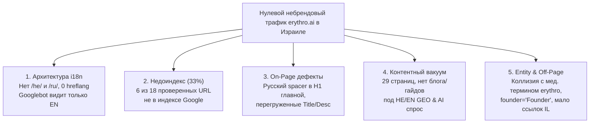

# Глубокий SEO-аудит `erythro.ai` в Израиле (2026-11-19)

> **Примечание:** В запросе указано `erythro.ail` — аудит выполнен по боевому домену **`https://erythro.ai/`** (подтверждён в Google Search Console и GA4 `properties/543568002`).

---

## 1. Executive Summary (Главный вывод)

На 19 ноября 2026 года **органическая видимость `erythro.ai` в Израиле находится на нулевом уровне по коммерческим запросам** и ограничивается **только 2 узкими брендовыми запросами** в англоязычном интерфейсе Google.

* **Возраст в индексе (по GSC):** первые показы зафиксированы **29 июня 2026 года** (~4,5 месяца).
* **Данные GSC (Израиль, вся история 2026-06-29 – 2026-11-17):** `14 кликов`, `64 показа`, `CTR 21.88%`, средняя позиция `2.48`. При этом **92.2% показов (59 из 64) и 100% кликов (14 из 14) скрыты как анонимизированные** (низкочастотные/брендовые/`site:` запросы).
* **Данные GA4 (Израиль, Organic Search, 2026-01-01 – 2026-11-19):** `127 сессий`, но всего **`6 уникальных пользователей`** — **100% с языком браузера Russian** (0 Hebrew, 0 English), со средней длительностью сессии **18,5 минут** (~21 сессия/чел.). Это с высокой вероятностью **внутренний трафик команды**, не исключённый фильтром IP (в Referral также фигурируют `localhost:3112` и `tagassistant.google.com`).
* **Главный системный блокер:** сайт имеет переводы на иврит (`HE`) и русский (`RU`) в CMS, но **реализовал переключение языка без отдельных URL (`/he/`, `/ru/`) и без `hreflang`**. Googlebot на всех 29 URL из `sitemap.xml` получает **только английский HTML (`lang="en" dir="ltr"`)**. Для израильского поиска на иврите и русском сайт **фактически не существует**.

---

## 2. По каким поисковым запросам `erythro.ai` находится в TOP 20 в Израиле?

Анализ выполнен методом триангуляции по трём независимым источникам:
1. **Google Search Console** (`https://erythro.ai/`, `countryFilter: ISR`, `2026-06-29` – `2026-11-17`).
2. **Живая выдача Google.co.il** (`location=Israel`, `gl=il`, `hl=en / iw / ru`, проверка позиций 1–20 через SerpApi).
3. **Google Analytics 4** (`properties/543568002`, срез `Israel` + `Organic Search`).

### 2.1. Подтверждённые запросы в TOP 20 (Израиль)

| Источник | Поисковый запрос | Язык (`hl`) | Позиция в Израиле | URL в выдаче | Комментарий |
| :--- | :--- | :---: | :---: | :--- | :--- |
| **Live SERP** | `erythro.ai` | `en` | **#1** (+ #2 IG, #3 LinkedIn, #4–5 YouTube) | `https://erythro.ai/` | Уверенная брендовая выдача в EN-интерфейсе |
| **Live SERP** | `erythro israel` | `en` | **#1** (+ #2 LinkedIn, #4 Privacy, #5 Terms) | `https://erythro.ai/contacts` | Ранжируется благодаря тексту *"Based in Eilat, Israel"* |
| **GSC (`ISR`)** | `ai` | — | **8.0** *(5 показов, 0 кликов)* | `https://erythro.ai/` | **Аномальный zero-click артефакт** (персонализация/AI-блок); в живом неперсонализированном SERP `google.co.il` сайт **отсутствует в Top 20** |
| **GSC (`ISR`)** | *(анонимизированные запросы)* | — | **~2.0** *(59 показов, 14 кликов)* | `/` и внутренние | Скрыты порогом приватности GSC; почти наверняка брендовые (`erythro.ai`, `site:erythro.ai`) и переходы команды |

> **Справка по глобальному GSC (все 32 страны, 18 кликов / 186 показов):** неанонимизированные запросы вне Израиля также носят характер артефактов/коллизий: `software development company` (#1, 3 показа в Египте/ОАЭ/Сауд. Аравии, 0 кликов), `software development services` (#1, 3 показа, 0 кликов), `ai` (#11.67 в Иордании, 3 показа), `understand medical terminology` (#2 в Канаде, 1 показ — коллизия с мед. корнем *erythro-*), `erythro` (#50.33 в Бразилии, 3 показа).

### 2.2. Брендовые запросы, где сайт НЕ попадает даже в TOP 20 (критическая уязвимость!)

| Запрос | Язык (`hl`) | Позиция (Top 20) | Кто вытесняет бренд в Израиле |
| :--- | :---: | :---: | :--- |
| `erythro ai` *(через пробел)* | `en` | **Нет в Top 20** | `launchboosts.com` (Yeri AI), YouTube `@RedoricAI`, стоки *red blood cells erythrocytes AI* (Vecteezy) |
| `erythro.ai` *(ивритский интерфейс)* | `iw` | **Нет в Top 20** | `launchboosts.com`, `@RedoricAI`, Vecteezy *erythrocytes*, `ErythroMer` (#17) |
| `erythro` | `en` | **Нет в Top 20** | Фарма и медицина: *Erythromycin*, *Erythrobase*, *Erythrocin*, *Wiktionary* |
| `איריתרו` *(транслитерация из Schema)* | `iw` | **Нет в Top 20** | Медицинские статьи на иврите (*אריתרומיצין* / эритромицин) |

**Почему так происходит:** слово `erythro` имеет мощнейший медицинский граф знаний (*erythrocytes*, *erythromycin*, `clalit.co.il`), а у домена `erythro.ai` пока недостаточно внешних сигналов доверия и **нет ни одной страницы на иврите**, чтобы Google ассоциировал бренд в `hl=iw`.

### 2.3. Коммерческие запросы в Израиле (EN / HE / RU — **0 из 19 в TOP 20**)

| Кластер | Проверенные запросы (`gl=il`) | Язык | Позиция `erythro.ai` | Лидеры выдачи в Израиле (Top-3) |
| :--- | :--- | :---: | :---: | :--- |
| **EN: AI / GEO Audit** | `ai website audit israel`, `ai visibility audit`, `geo optimization agency israel`, `ai readiness audit`, `website audit israel` | `en` | **Нет в Top 20** | `getaiso.com`, `kalech.com`, `imaginet.co.il`, `grigoriev.co.il`, `eyefulmedia.com`, `agencylist.com` |
| **EN: Dev & AI Auto** | `ai automation agency israel`, `custom web development agency israel`, `next.js agency israel` | `en` | **Нет в Top 20** | `auto-flow.co.il`, `skylonnet.co.il`, `livesites.co.il/en/nextjs-website-development.html`, `techbehemoths.com`, `easy.co.il` |
| **HE: AI / GEO Audit** | `בדיקת אתר ai`, `קידום אתרים במנועי ai`, `קידום אתרים geo`, `בדיקת קידום אתרים` | `iw` | **Нет в Top 20** | `websight.co.il/he/seo-geo-guide/`, `captaindigital.co.il/seo-automation/`, `seotitles.co.il`, `ganbaru.co.il`, `ibastom.com`, `optiwise.co.il` |
| **HE: Auto & Web Dev** | `אוטומציה עסקית ai`, `בניית אתרים ai`, `בניית אתרים לעסקים` | `iw` | **Нет в Top 20** | `bizibiz.co.il`, `clickpoint-media.com`, `deltacomputer.co.il`, `webs.co.il`, `mako.co.il`, Facebook-видео |
| **RU: Israel** | `создание сайтов израиль`, `ai автоматизация бизнеса израиль`, `аудит сайта израиль` | `ru` | **Нет в Top 20** | `masamedia.co.il`, `pdgstudio.net`, `enter2web.co.il/ru/`, `neolines.co.il`, `next-gen.live` |

> **Важное наблюдение по SERP Израиля:** на **100% проверенных запросов (24 из 24)** в Google.co.il отображается **Google AI Overview (`AIO=True`)**! Это значит, что классический SEO обязан идти в связке с GEO/структурированным экспертным контентом.

---

## 3. Аналитика трафика: GSC vs GA4 (Израиль)

### 3.1. Google Search Console (`https://erythro.ai/`, `ISR`)
* **Всего за 2026-06-29 – 2026-11-17:** 14 кликов, 64 показа, CTR 21.88%, ср. позиция 2.48.
* **По устройствам (`ISR`):**
  * `MOBILE`: 10 кликов, 32 показа, CTR 31.25%, ср. поз. 2.91.
  * `DESKTOP`: 4 клика, 32 показа, CTR 12.50%, ср. поз. 2.06.
* **Динамика:** 7 из 14 кликов пришлись на один день — `2026-09-16` (CTR 100%, 7/7). В ноябре 2026 зафиксирован всего **1 клик** из Израиля (`2026-11-06`).
* **Страницы (глобальный срез GSC, `byPage`):** 23 из 29 страниц получали хотя бы 1 показ (`/` — 13 кликов / 146 показов, `/portfolio` — 4 / 70, `/services/ai-automation` — 1 / 51, `/services/development` — 0 / 68, `/privacy` — 0 / 36, `/terms` — 0 / 29). Высокое число показов `/privacy` и `/terms` на позициях 4–6 — типичный маркер проверок через `site:erythro.ai` или брендового поиска `erythro israel`.

### 3.2. Google Analytics 4 (`properties/543568002`, Израиль, 2026-01-01 – 2026-11-19)

| Канал (Израиль) | Сессии | Пользователи | Engaged Sessions | Engagement Rate | Ср. длительность | Просмотры |
| :--- | :---: | :---: | :---: | :---: | :---: | :---: |
| **Direct** | 722 | 74 | 495 | 68.6% | 14м 38с | 3 730 |
| **Paid Social** | 288 | 252 | 119 | 41.3% | 1м 17с | 320 |
| **Organic Search** | 127 | **6** | 85 | 66.9% | **18м 34с** | 554 |
| **Paid Search** | 85 | 11 | 63 | 74.1% | 20м 46с | 436 |
| **Organic Social** | 75 | 15 | 50 | 66.7% | 12м 43с | 206 |
| **Referral** | 42 | 1 | 27 | 64.3% | 23м 26с | 127 |
| **Unassigned / Video** | 12 | 6 | 3 | — | — | 29 |

**Ключевой инсайт из GA4 по языкам аудитории в Израиле:**
* **Все каналы вместе (Израиль):** иврит (`Hebrew`) — **142 пользователя**, английский (`English`) — **94 пользователя**, русский (`Russian`) — **90 пользователей** (1 085 сессий).
* **Только `Organic Search` (Израиль):** `Russian` — **6 пользователей (127 сессий)**, `Hebrew` — **0**, `English` — **0**.
* **Конверсии из органики:** 0 отправленных заявок (зафиксировано только 11 событий `form_start` от 1 пользователя).
* **Проблема чистоты аналитики:** в `Referral` зафиксировано 19 сессий с `localhost:3112` и 4 сессии с `tagassistant.google.com` — внутренний трафик разработчиков не отфильтрован в GA4.

---

## 4. Технический и On-Page SEO-аудит (29 URL из `sitemap.xml` + поддомены)



### 4.1. Критическая проблема №1 — Сломанная мультиязычность для SEO (Blocker)
Проверено прямым краулингом с `User-Agent: Googlebot`:
* Все **29 URL** из `https://erythro.ai/sitemap.xml` возвращают `HTTP 200`, но исключительно **`<html lang="en" dir="ltr">`** и английский контент (0 тегов `hreflang`, `has_hebrew = False` на всех коммерческих страницах).
* Пути `/he`, `/ru`, `/en` отдают **`404 Not Found`**.
* Заголовки `Accept-Language: he-IL` / `ru-RU`, параметры `?lang=he` / `?locale=he` и cookie `locale=he` / `NEXT_LOCALE=he` **не меняют SSR HTML** — Googlebot всегда индексирует только английскую версию.
* Рекламные поддомены (`leak-he.erythro.ai`, `leak-en.erythro.ai`, `audit-he.erythro.ai`, `audit-en.erythro.ai`, `audit-ru.erythro.ai`) отдают заголовок **`X-Robots-Tag: noindex, nofollow`** (корректно для PPC, чтобы не плодить дубли), однако на `leak-he.erythro.ai`, `audit-he.erythro.ai` и `/lp/audit/he` в HTML указан неверный атрибут **`<html lang="en" dir="ltr">`** (хотя контент на иврите!), а в `<meta name="robots">` стоит конфликтующее `index, follow`.

### 4.2. Критическая проблема №2 — Недоиндекс важных страниц (GSC URL Inspection API)
Проверено 18 ключевых URL из 29 в `sitemap.xml`:
* **В индексе (`Submitted and indexed` — 12 из 18):** `/`, `/services/ai-automation`, `/services/development`, `/services/design-branding`, `/services/enterprise-engineering`, `/audit`, `/about`, `/portfolio`, `/contacts`, `/portfolio/la-scala`, `/portfolio/mustang-6663rt`, `/order/business-automation`.
* **НЕ в индексе (`6 из 18 — 33%`):**
  * `URL is unknown to Google`:
    * `https://erythro.ai/services/management` *(одна из 5 основных страниц услуг!)*
    * `https://erythro.ai/portfolio/ai-consultant` *(флагманский AI-кейс!)*
    * `https://erythro.ai/portfolio/ai-audit-agent` *(флагманский кейс AI-аудитора!)*
    * `https://erythro.ai/portfolio/ember`
  * `Discovered - currently not indexed`:
    * `https://erythro.ai/portfolio/ora-60a`
    * `https://erythro.ai/portfolio/rosso-garage`
* **В GSC подключён только URL-prefix (`https://erythro.ai/`)** вместо Domain Property (`sc-domain:erythro.ai`), из-за чего поддомены (`leak-*`, `audit-*`, демо-кейсы `ember.*`, `ora60a.*`) выпадают из единого мониторинга.

### 4.3. Критическая проблема №3 — Дефекты On-Page, H1 и Schema.org

1. **Скрытый русский текст и отсутствие ключей в `<h1>` главной (`/`):**
   ```html
   <h1>
     <div>
       <span aria-hidden="true" class="invisible">МАСШТАБИРУЕМЫЕ СИСТЕМЫ</span>
       <span class="absolute inset-0">ENGINEERING FUTURE</span>
     </div>
   </h1>
   ```
   * Невидимый spacer на кириллице (`МАСШТАБИРУЕМЫЕ СИСТЕМЫ`) склеивается в DOM с английским `ENGINEERING FUTURE` на странице `lang="en"` — это даёт смешанный языковой сигнал поисковику.
   * Видимый `<h1>` (`ENGINEERING FUTURE`) — абстрактный слоган без единого коммерческого ключевого слова (*AI Automation*, *Web Development*, *AI Website Audit*, *Israel*).
2. **Ошибки в `Organization` JSON-LD (удар по E-E-A-T и Knowledge Graph):**
   * `"founder": { "@type": "Person", "name": "Founder" }` — стоит заглушка **`"Founder"`** вместо реального имени **`"Vadym Kovalenko"`** (при этом его профиль LinkedIn уже ранжируется #3 по запросу `erythro.ai`!).
   * В массиве `sameAs` **отсутствуют Instagram (`https://www.instagram.com/erythro.ai/`) и YouTube-канал (`https://www.youtube.com/@ErythroAi`)**, которые уже занимают #2, #4 и #5 в выдаче по бренду. Ссылка на Facebook дана через временный share-URL (`facebook.com/share/1DKaM3k5ox/`) вместо канонического URL страницы.
3. **Длина Title и Meta Description (требуют оптимизации под CTR):**
   * **Обрезаются в SERP (Title > 60 симв.):**
     * `/services/ai-automation` — **84 симв.** (*AI & Automation Services: Custom AI Agents, Chatbots & Voice AI | Erythro.ai*)
     * `/order/business-automation` — **84 симв.**
     * `/services/development` — **80 симв.**
     * `/services/enterprise-engineering` — **73 симв.**
     * `/order/ai-smart-card` — **73 симв.**
     * `/services/design-branding` — **69 симв.**
   * **Слишком короткие/неинформативные Title (< 35 симв.):** `/contacts` (21), `/portfolio` (22), `/about` (29), `/services/management` (34).
   * **Переполненные Meta Description (> 160 симв.):** `/services/design-branding` (251), `/order/business-automation` (216), `/services/enterprise-engineering` (208), `/services/development` (194), `/services/ai-automation` (192).
   * **Слабая гео-привязка к рынку Израиля:** в Title ключевых услуг нет упоминания `Israel` / `ישראל`, а на `/about` и `/contacts` фигурирует только `Eilat, Israel` (стоит явно указывать *"Serving businesses across Israel (Tel Aviv, Haifa, Jerusalem, Eilat) & globally"*).
4. **Скорость ответа сервера (TTFB) и кэширование:**
   * При обходе Googlebot время ответа составило **850–1 560 ms** на большинстве страниц.
   * Ключевая лидогенерирующая страница **`https://erythro.ai/audit`** отдаётся с заголовком **`Cache-Control: private, no-cache, no-store`** (`x-vercel-cache: MISS`), что лишает её edge-кэширования (рекомендуется перевести статическую оболочку `/audit` на ISR/PPR, оставив динамическими только клиентские запросы отчёта).

### 4.4. Сильные стороны (что уже сделано отлично)
* **Образцовый AI-readiness / Agent Discovery:** `llms.txt`, `/.well-known/mcp`, `/.well-known/api-catalog`, `/openapi.json`, `Content-Signal: ai-train=no, search=yes, ai-input=yes`, корректный `robots.txt` с `Allow: /` для `GPTBot`, `ClaudeBot`, `PerplexityBot`, `Google-Extended`.
* **Сильные Security Headers:** HSTS, CSP, `X-Frame-Options`, `X-Content-Type-Options`, `Referrer-Policy`, `Permissions-Policy`.
* **Канонизация редиректов:** `http://erythro.ai` и `https://www.erythro.ai` корректно ведут на `https://erythro.ai/`.
* **Чистая базовая Schema:** `Organization`, `WebSite`, `FAQPage` (на главной, услугах и `/audit`), `WebApplication` (на `/audit`).
* **Хороший объём текста на кейсах и услугах:** 740–1 446 слов на основных страницах (достаточно для ранжирования при наличии локализации и ссылок).

---

## 5. Приоритезированный план действий (SEO Roadmap для Израиля)

### P0 — Критические исправления (1–2 недели, максимальный ROI)

1. **Внедрить URL-based мультиязычность (`/he/`, `/ru/`, `/` или `/en/`) + двусторонний `hreflang` + локализованный `sitemap.xml`:**
   * Каждая страница (главная, 5 услуг, `/audit`, `/about`, `/contacts`, `/portfolio` и кейсы) должна иметь отдельные SSR-маршруты:
     * `https://erythro.ai/` (`en`, `x-default`)
     * `https://erythro.ai/he/...` (`he-IL`, `<html lang="he" dir="rtl">`)
     * `https://erythro.ai/ru/...` (`ru-IL` или `ru`, `<html lang="ru" dir="ltr">`)
   * Добавить `<link rel="alternate" hreflang="en" ...>`, `hreflang="he-IL"`, `hreflang="ru"`, `hreflang="x-default"` на каждую страницу и включить все локали в `sitemap.xml` (29 × 3 ≈ 87 URL).
   * Исправить `<html lang="he" dir="rtl">` на `leak-he.erythro.ai`, `audit-he.erythro.ai` и `/lp/audit/he`.
2. **Исправить `<h1>` главной страницы (`/`):**
   * Убрать невидимый русский spacer (`МАСШТАБИРУЕМЫЕ СИСТЕМЫ`) из тега `<h1>` (использовать `min-h` или CSS-контейнер вне заголовка `<h1>`, либо фиксированный `<h1>` на языке текущей локали).
   * Задать коммерчески релевантный `<h1>`:
     * EN: *AI Website Audit, Automation & Enterprise Web Development in Israel*
     * HE: *בניית אתרים מתקדמים, אוטומציה עסקית וביקורת AI/GEO בישראל*
     * RU: *AI-аудит сайтов, автоматизация бизнеса и веб-разработка в Израиле*
3. **Починить `Organization` JSON-LD (Entity Disambiguation против медицинского `erythro`):**
   * Заменить `"founder": {"name": "Founder"}` на `"name": "Vadym Kovalenko"`.
   * Добавить в `sameAs`: `https://www.instagram.com/erythro.ai/`, `https://www.youtube.com/@ErythroAi`, заменить Facebook share-ссылку на постоянный URL страницы.
   * Добавить `areaServed` с упоминанием Tel Aviv / Israel.
4. **Доиндексировать 6 выпавших URL и обновить GSC/GA4:**
   * Проверить внутренние ссылки на `/services/management`, `/portfolio/ai-consultant`, `/portfolio/ai-audit-agent`, `/portfolio/ember`, `/portfolio/ora-60a`, `/portfolio/rosso-garage` (убедиться, что все они доступны в SSR-HTML из меню/карточек без JS-зависимости) и отправить на ручную переиндексацию в GSC.
   * Добавить в GSC **Domain Property `sc-domain:erythro.ai`**.
   * В GA4 настроить **Internal Traffic Filter** (исключить IP команды + `localhost`), чтобы видеть реальную органику.

### P1 — On-Page & Коммерческая семантика Израиля (2–4 недели)

5. **Переписать Title (50–60 симв.) и Description (140–155 симв.) для всех локалей (`HE` / `EN` / `RU`):**
   * Приоритетные кластеры под иврит (`/he/`):
     * `/he/audit` → *ביקורת אתר AI חינם: בדיקת SEO, GEO ונראות ב-ChatGPT | Erythro.ai*
     * `/he/services/ai-automation` → *אוטומציה עסקית וסוכני AI לעסקים בישראל | Erythro.ai*
     * `/he/services/development` → *בניית אתרים מתקדמים ב-Next.js ופיתוח מותאם אישית | Erythro.ai*
   * Приоритетные кластеры под английский (`/`):
     * `/audit` → *Free AI Website Audit: SEO, CRO & GEO Score | Erythro.ai*
     * `/services/ai-automation` → *AI Automation & Custom AI Agents in Israel | Erythro.ai*
     * `/services/development` → *Next.js & Enterprise Web Development in Israel | Erythro.ai*
6. **Оптимизировать TTFB и кэширование `/audit`:**
   * Перевести `/audit` с `private, no-cache, no-store` на статическую/ISR-оболочку (edge HIT), снизив TTFB с ~950 ms до <250 ms.

### P2 — Контент-хаб (GEO + SEO) и Off-Page в Израиле (1–3 месяца)

7. **Запустить раздел `/blog` (на `HE` + `EN`) под высокоинтентный спрос Израиля с низкой конкуренцией:**
   * Спрос на `קידום אתרים geo` / `קידום אתרים במנועי ai` / `בדיקת נראות ב-ChatGPT` в Израиле сейчас занимает всего 4–5 локальных агентств (`websight.co.il`, `captaindigital.co.il`, `seotitles.co.il`, `kalech.com`, `imaginet.co.il`).
   * Первые 6 приоритетных статей (HE + EN, с перелинковкой на `/he/audit` и `/audit`):
     1. *מדריך קידום אתרים במנועי AI (GEO) בישראל 2026–2027* (`קידום אתרים geo`, `קידום אתרים במנועי ai`)
     2. *איך לבדוק נראות אתר ב-ChatGPT, Perplexity ו-Google AI Overview* (`בדיקת אתר ai`, `בדיקת נראות ב-chatgpt`)
     3. *איך להטמיע `llms.txt` ו-Schema.org לעסקים בישראל*
     4. *אוטומציה עסקית עם סוכני AI ו-WhatsApp לעסקים בישראל: עלויות ו-ROI*
     5. *Next.js vs WordPress לבניית אתר עסקי בישראל: מהירות, SEO והמרות*
     6. *How Israeli B2B Companies Lose Leads: CRO & AI Visibility Benchmark* (EN)
8. **Локальный Off-Page и Брендовые цитирования в Израиле (для победы над `erythro` = эритромицин):**
   * Зарегистрировать и верифицировать **Google Business Profile** (Erythro.ai — Software / Digital Agency, Israel, зона обслуживания: весь Израиль, на иврите и английском).
   * Создать/усилить профили с обратными ссылками и единым NAP (`Erythro.ai`, `+972-50-530-8305`, `team@erythro.ai`): **Easy.co.il**, **B144**, **Clutch.co**, **TechBehemoths** (они уже #2 по `next.js agency israel`!), **GoodFirms**, **Sortlist**, **LinkedIn Company Page** (сейчас есть только личный профиль основателя!).
   * Разместить 2–3 гостевых экспертных кейса/статьи на израильских tech/marketing площадках (`Geektime`, `Ice`, профильные Telegram/LinkedIn-сообщества Израиля) с анкорами `Erythro.ai` / `Erythro AI`.

---

## 6. KPI и цели на 90 дней

| Метрика | Факт (2026-11-19) | Цель через 90 дней |
| :--- | :---: | :---: |
| Индексация URL в GSC | ~67% (12/18 пров., только EN) | **>95%** всех `EN + HE + RU` URL (~85+ страниц) |
| Брендовые запросы в Top 3 (`IL`) | 2 (`erythro.ai` EN, `erythro israel` EN) | **5+** (включая `erythro ai`, `erythro.ai` HE, `איריתרו`) |
| Коммерческие запросы в Top 20 (`IL`) | **0** | **15–25** (прежде всего кластеры `GEO / AI Audit` на HE и EN) |
| Органические показы в Израиле / мес | ~15–20 | **1 500 – 3 000+** |
| Органические клики из Израиля / мес | ~1–2 (команда) | **80 – 150+** реальных B2B-пользователей |
| Лиды на бесплатный AI-аудит из органики | 0 | **10 – 20+ / мес** |
