# 🧠 База знаний Erythro.ai — RAG Knowledge Base

> **Корпоративный диспетчер знаний, архитектурных стандартов и регламентов для AI-агентов и разработчиков.**  
> Создано для обеспечения преемственности архитектуры, предотвращения рецидивов ошибок (Pitfalls) и быстрого развертывания новых AI-проектов.
> **Sync (2026-08-28):** зеркала `erythro-ai/docs/*` добавлены/обновлены (playbook, deployment, ai-visibility, hero-motion, rag-index, import-project, cms-field-map, case-study-template, pitfalls PIT-001…026). Правило двухсторонней синхронизации: правки docs ↔ Knowledge-Base.

---

## 🗺️ Карта контекста (Context Map & Navigation)

```mermaid
graph TD
    INDEX["📄 index.md (Главный диспетчер)"]
    
    subgraph "01 Architecture"
        ARCH_BE["[[backend-architecture|Бэкенд и CMS]]"]
        ARCH_FE["[[frontend-architecture|Фронтенд и UI]]"]
        ARCH_AI["[[ai-agent-architecture|AI-агенты и Протоколы]]"]
        ARCH_OPS["[[devops-infra-architecture|Инфраструктура и CI/CD]]"]
        ARCH_DEPLOY["[[deployment|Deployment journal]]"]
        ARCH_PLAY["[[playbook|Playbook продукта]]"]
        ARCH_AIVIS["[[ai-visibility|AI Visibility]]"]
        ARCH_RAG["[[rag-evaluation-guide|Оценка и оптимизация RAG]]"]
        ARCH_SPRING["[[spring-boot-oauth2-architecture|Spring Boot Стек]]"]
        ARCH_GOOGLE["[[google-oauth2-integration-guide|Google OAuth2 OIDC]]"]
        ARCH_X["[[x-oauth2-integration-guide|X (Twitter) OAuth2 PKCE]]"]
        ARCH_EMAIL["[[email-service-cid-analysis|Email Service CID]]"]
        ARCH_LEGAL["[[compliance-legal-architecture|Комплаенс, IS 5568 & GDPR]]"]
    end
    
    subgraph "02 Design Tokens"
        TOK_FIGMA["[[figma-design-pipeline|Figma Design Pipeline]]"]
        TOK_COL["[[foundations-colors|Цвета и Темы]]"]
        TOK_TYP["[[foundations-typography|Типографика и RTL]]"]
        TOK_GEO["[[foundations-geometry|Сетки и Отступы]]"]
        TOK_ANI["[[foundations-animations|GSAP и Анимации]]"]
        TOK_HERO["[[hero-motion|Hero Motion]]"]
        TOK_CMP["[[components-rules|Компоненты UI]]"]
    end
    
    subgraph "03 Agent Skills"
        SKILL_PROMPT["[[prompt-engineering-rules|Промпт-инжиниринг]]"]
        SKILL_MCP["[[mcp-agent-skill|MCP Протокол]]"]
        SKILL_ACP["[[acp-commerce-skill|ACP Коммерция]]"]
        SKILL_MD["[[markdown-negotiation-skill|Markdown Negotiation]]"]
        SKILL_QA["[[qa-website-auditor-skill|QA Website Auditor]]"]
        SKILL_L1["[[prompt-add-vercel-agent-readiness|Vercel L1 Agent Checks]]"]
        SKILL_CMS["[[cms-content-agent-skill|CMS Контент-агенты]]"]
        SKILL_IMPORT["[[import-project|Import Project]]"]
        SKILL_SPRING["[[spring-oauth2-auth-skill|Spring OAuth2 Внедрение]]"]
        SKILL_EMAIL["[[transactional-email-skill|Email с CID Inline]]"]
        SKILL_SEO["[[seo-analytics-agent-skill|SEO Analytics Agent]]"]
        SKILL_GIT["[[obsidian-git-sync-rule|Obsidian Git Sync]]"]
    end
    
    subgraph "04 Templates"
        TPL_BRIEF["[[brief-yaml-cms-template|CMS Field Map & Brief]]"]
        TPL_FIELDMAP["[[cms-field-map|CMS Field Map (repo)]]"]
        TPL_SPRING["[[oauth2-spring-config-template|Spring OAuth2 Config]]"]
        TPL_CASE["[[portfolio-case-template|Шаблон кейса YAML]]"]
        TPL_CASEMD["[[case-study-template|Шаблон кейса MD]]"]
        TPL_SERV["[[service-page-template|Шаблон услуги]]"]
        TPL_ORD["[[solution-order-template|Шаблон тарифа]]"]
        TPL_SEO["[[seo-metadata-template|Шаблон SEO/Schema]]"]
        TPL_LEG["[[legal-page-template|Шаблон Legal/WCAG]]"]
    end
    
    subgraph "05 Glossary & FAQ"
        PIT["[[pitfalls-troubleshooting|Каталог факапов (PIT-001..026)]]"]
        RAG["[[rag-index|RAG Index / ingest map]]"]
        GLOSS["[[technical-glossary|Глоссарий терминов]]"]
        FAQ["[[architectural-faq|Архитектурный FAQ]]"]
    end

    INDEX --> ARCH_BE & ARCH_FE & ARCH_AI & ARCH_OPS & ARCH_DEPLOY & ARCH_PLAY & ARCH_AIVIS & ARCH_RAG & ARCH_SPRING & ARCH_GOOGLE & ARCH_X & ARCH_EMAIL & ARCH_LEGAL
    INDEX --> TOK_FIGMA & TOK_COL & TOK_TYP & TOK_GEO & TOK_ANI & TOK_HERO & TOK_CMP
    INDEX --> SKILL_PROMPT & SKILL_MCP & SKILL_ACP & SKILL_MD & SKILL_QA & SKILL_L1 & SKILL_CMS & SKILL_IMPORT & SKILL_SPRING & SKILL_EMAIL & SKILL_SEO & SKILL_GIT
    INDEX --> TPL_BRIEF & TPL_FIELDMAP & TPL_SPRING & TPL_CASE & TPL_CASEMD & TPL_SERV & TPL_ORD & TPL_SEO & TPL_LEG
    INDEX --> PIT & RAG & GLOSS & FAQ
```

---

## 📂 Структура разделов

### [[01-Architecture/backend-architecture|📁 01-Architecture (Архитектура систем)]]
- **[[rag-evaluation-guide|rag-evaluation-guide.md]]** — Комплексный регламент тестирования, метрик качества (Ragas, Phoenix), устранения узких мест (Lost in the Middle, Chunking, Re-ranking) и E2E-оценки RAG-пайплайнов.
- **[[google-oauth2-integration-guide|google-oauth2-integration-guide.md]]** — Полное руководство по настройке Google OAuth 2.0 (OIDC, scopes `openid,profile,email`, `DefaultOAuth2UserService`, cookies `same-site=none`).
- **[[x-oauth2-integration-guide|x-oauth2-integration-guide.md]]** — Полное руководство по настройке X (Twitter) OAuth 2.0 (PKCE S256, Code Verifier, `client_secret_basic`, кастомный `TwitterOAuth2UserService` для парсинга `{ "data": { ... } }`, генерация виртуального `username@x.local`).
- **[[email-service-cid-analysis|email-service-cid-analysis.md]]** — Глубокий анализ отправки HTML-писем с inline-вложениями (Content-ID `cid:xxx`), почему почтовики блокируют base64 и внешние URL, сборка `emailBody` и `inlineImages` в `OrderController`.
- **[[spring-boot-oauth2-architecture|spring-boot-oauth2-architecture.md]]** — Сводная архитектура Spring Boot 3 + Spring Security 6 с PKCE, сессиями за Nginx и транзакционным почтовым сервисом.
- **[[backend-architecture|backend-architecture.md]]** — Payload CMS 3.0, PostgreSQL/Drizzle, мультиязычные схемы (EN/RU/HE), REST/GraphQL API, On-Demand Revalidation.
- **[[frontend-architecture|frontend-architecture.md]]** — Next.js 15 App Router, React 19, TypeScript strict, Tailwind CSS, стресс-тестирование длины строк (+40%), логические свойства (RTL).
- **[[ai-agent-architecture|ai-agent-architecture.md]]** — MCP (Model Context Protocol), ACP (Agentic Commerce Protocol), `llms.txt`, Markdown Content Negotiation, Schema.org.
- **[[devops-infra-architecture|devops-infra-architecture.md]]** — Vercel Serverless, Supabase Postgres, Cloudflare WAF/DNS/Rate Limiting, Hostinger SMTP, Docker, GitHub Actions CI/CD.
- **[[deployment|deployment.md]]** — Журнал деплоя erythro.ai (Vercel, Blob, миграции, CI, DNS, почта, AI Crawl Control). Synced from `docs/DEPLOYMENT.md`.
- **[[playbook|playbook.md]]** — Продуктовый playbook и хронология v1 (фазы A–F, i18n, GSAP, CMS). Synced from `docs/PLAYBOOK.md`.
- **[[ai-visibility|ai-visibility.md]]** — AI visibility pack: llms.txt, MCP, schema, Content Signals, markdown negotiation. Synced from `docs/AI_VISIBILITY.md`.
- **[[compliance-legal-architecture|compliance-legal-architecture.md]]** — Поправка №13 к закону о защите конфиденциальности (Израиль), Документ определения базы данных (DBD), шифрование бэкапов AES-256-GCM, IS 5568 / WCAG 2.1 AA, GDPR и EU AI Act.

### [[02-Design-Tokens/foundations-colors|📁 02-Design-Tokens (Дизайн-система)]]
- **[[figma-design-pipeline|figma-design-pipeline.md]]** — 5-этапный регламент создания дизайна в Figma: Сетки (1920/1170/768/390), линейка отступов 4/8px, Primitives, Семантика тем, Иконки 24×24px, Auto-Layout, Изолированные оверлеи, Definition of Done.
- **[[foundations-colors|foundations-colors.md]]** — Палитра Primitives (Coal/Erythro/Gold), семантические токены (`--bg-primary`, `--bg-surface`), процедурный шум 5%, темная/светлая тема.
- **[[foundations-typography|foundations-typography.md]]** — Шрифтовая матрица: Inter (Latin/Cyrillic), Heebo (Hebrew/RTL), Roboto Mono (Data/Tech), типографическая шкала.
- **[[foundations-geometry|foundations-geometry.md]]** — Адаптивная 12-колоночная сетка 1170px, колонки 70px, гаттеры 30px, масштаб отступов `space-xs..xl`, радиусы скруглений.
- **[[foundations-animations|foundations-animations.md]]** — GSAP 3 + ScrollTrigger, Hero Interactive Canvas Sequence (110 кадров WebP), плавность состояний `transition-all duration-300`.
- **[[hero-motion|hero-motion.md]]** — Спецификация Hero Motion (кадры, pin, copy). Synced from `docs/HERO_MOTION.md`.
- **[[components-rules|components-rules.md]]** — Правила создания компонентов: Navbar, Mobile Menu Overlay, Hero, Service Cards, Solutions, Portfolio, Contact Modal, SplashHost.

### [[03-Agent-Skills/prompt-engineering-rules|📁 03-Agent-Skills (Регламенты AI-агентов)]]
- **[[prompt-engineering-rules|prompt-engineering-rules.md]]** — Стандарты промптов для кодинг-ассистентов (Antigravity, Cursor, Claude 3.7, GPT-4o), предотвращение галлюцинаций.
- **[[mcp-agent-skill|mcp-agent-skill.md]]** — Спецификация SEP-1960 MCP, Discovery Manifest `/.well-known/mcp`, эндпоинт brand facts.
- **[[acp-commerce-skill|acp-commerce-skill.md]]** — Спецификация Agentic Commerce Protocol, `/.well-known/acp.json`, capability negotiation, заказы и чекаут.
- **[[markdown-negotiation-skill|markdown-negotiation-skill.md]]** — Реализация `Accept: text/markdown`, подсчет токенов `x-markdown-tokens`, отдача чистого текста для LLM.
- **[[qa-website-auditor-skill|qa-website-auditor-skill.md]]** — Автономный QA-аудитор: ~60 проверок (Mobile UX, RTL, Forms, SEO, Speed, Security, AI Readiness), генерация многоязычных PDF.
- **[[prompt-add-vercel-agent-readiness|prompt-add-vercel-agent-readiness.md]]** — Промпт для агента: добавить в QA_Auditor проверки Vercel Level 1 (robots.txt, Sitemap, AI Crawler Rules, Content Signals, Markdown Negotiation).
- **[[cms-content-agent-skill|cms-content-agent-skill.md]]** — Автономный контент-менеджмент через n8n и CLI-скрипты, импорт кейсов из папок, сериализация Lexical.
- **[[import-project|import-project.md]]** — Pointer на `scripts/import-project` (brief.yaml → CMS). Synced from `docs/IMPORT_PROJECT.md`.
- **[[spring-oauth2-auth-skill|spring-oauth2-auth-skill.md]]** — Пошаговая инструкция по настройке Spring Boot с Google и X (Twitter) OAuth2 PKCE.
- **[[transactional-email-skill|transactional-email-skill.md]]** — Регламент верстки транзакционных писем с гарантированной поддержкой картинок через CID (JavaMailSender / Nodemailer).
- **[[seo-analytics-agent-skill|seo-analytics-agent-skill.md]]** — Автономный Java SEO Analytics Agent: SerpApi, 24h кэш (Redis+Caffeine), строгая локализация (RU/EN/HE), предобработка данных для LLM (-85% токенов), Gemini 3.6 Flash.
- **[[obsidian-git-sync-rule|obsidian-git-sync-rule.md]]** — Обязательное правило и протокол синхронизации базы знаний с GitHub репозиторием при любых изменениях (Agent rules + Obsidian Git plugin).

### [[04-Templates/portfolio-case-template|📁 04-Templates (Шаблоны артефактов)]]
- **[[brief-yaml-cms-template|brief-yaml-cms-template.md]]** — Полная матрица соответствия полей между `brief.yaml` и PostgreSQL/Payload CMS.
- **[[cms-field-map|cms-field-map.md]]** — Field map кейс → Portfolio Projects (из репо). Synced from `docs/cases/CMS_FIELD_MAP.md`.
- **[[case-study-template|case-study-template.md]]** — Markdown-шаблон кейса с плейсхолдерами. Synced from `docs/cases/case-study-template.md`.
- **[[oauth2-spring-config-template|oauth2-spring-config-template.md]]** — Готовые шаблоны `application.properties` и `SecurityConfig.java` для Spring Boot OAuth2.
- **[[portfolio-case-template|portfolio-case-template.md]]** — Полный шаблон кейса портфолио (`brief.yaml`), структура медиа, стек, тело статьи.
- **[[service-page-template|service-page-template.md]]** — Шаблон страницы услуги (Hero, Summary, Offerings, Тарифы, Возможности, SEO).
- **[[solution-order-template|solution-order-template.md]]** — Шаблон тарифного плана заказа (базовая цена, периоды, скидки, аддоны, налоги).
- **[[seo-metadata-template|seo-metadata-template.md]]** — Шаблоны generateMetadata, OpenGraph, Twitter Cards, Canonical alternates, JSON-LD (Organization, WebSite, FAQPage).
- **[[legal-page-template|legal-page-template.md]]** — Шаблоны юридических документов: Privacy Policy, Terms of Service, Accessibility Statement (IS 5568 / WCAG 2.1 AA).

### [[05-Glossary-FAQ/pitfalls-troubleshooting|📁 05-Glossary-FAQ (База инцидентов и FAQ)]]
- **[[pitfalls-troubleshooting|pitfalls-troubleshooting.md]]** — Каталог известных факапов (`PIT-001` – `PIT-026`): симптомы, причины, проверенные решения и правила профилактики. Synced from `docs/PITFALLS.md`.
- **[[rag-index|rag-index.md]]** — Ingest map для RAG (chunking, tags, routing). Synced from `docs/RAG_INDEX.md`.
- **[[technical-glossary|technical-glossary.md]]** — Алфавитный глоссарий терминов: MCP, ACP, RAG, ISR, Drizzle, Lexical, GSAP, TTFB, CSP, HSTS, WCAG.
- **[[architectural-faq|architectural-faq.md]]** — Ответы на частые архитектурные вопросы для быстрого старта новых клиентских проектов.
